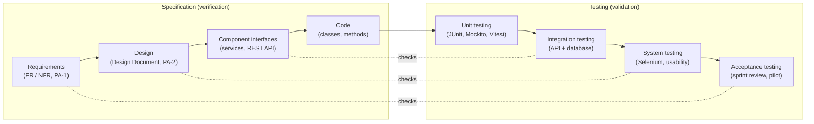
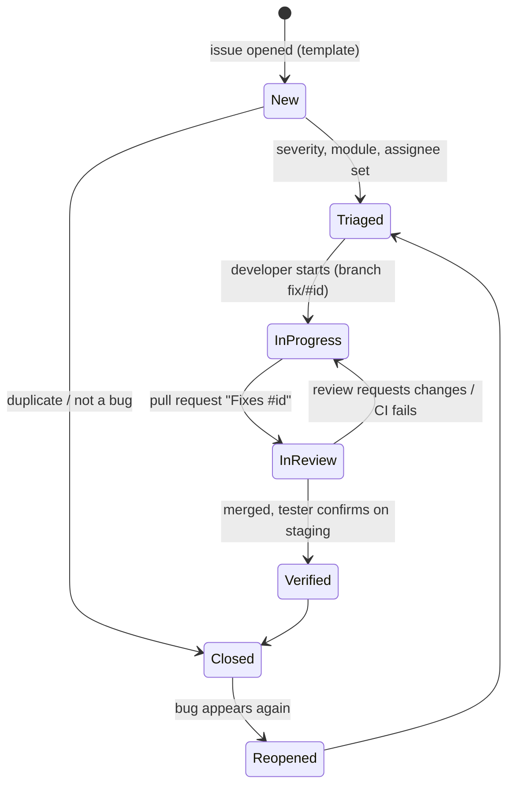

# Quality Assurance (QA) Plan

**Project:** CampusBridge — Erasmus & Local Student Matching Platform\
**Course:** BIL 481 Software Engineering — Fall 2026, TOBB ETÜ\
**Assignment:** Project Assignment 2 (PA-2) — Design and Quality Assurance\
**Group:** Sangre y Oro\
**Version / Date:** 1.0 — 15-11-2026

**List of contributors:**

| Full Name | GitHub Username | School Number | Main contribution to this document |
| --- | --- | --- | --- |
| Turgay Samet Şentürk | @turgaysamet | 221104087 | Usability testing, acceptance testing, bug tracking process |
| Alejandro Blas Piris | @Blas-24 | 261118081 | Frontend and system (UI) testing, usability metric |
| Carlos Molina Perez | @Camope345 | 261118083 | CI pipeline, integration/performance/security testing, test environments |
| Alberto Alvarez Polo | @903155 | 261118082 | QA strategy, quality factors and metrics, test cases, unit tests (QA lead) |

## Table of Contents

1. [Quality Assurance Strategy](#1-quality-assurance-strategy)
   1. [Overview](#11-overview)
   2. [Testing Methodologies](#12-testing-methodologies)
   3. [Automated vs. Manual Testing](#13-automated-vs-manual-testing)
   4. [Test Environments and Tools](#14-test-environments-and-tools)
   5. [Entry and Exit Criteria](#15-entry-and-exit-criteria)
2. [Quality Factors and Metrics](#2-quality-factors-and-metrics)
3. [Test Plan](#3-test-plan)
   1. [Test Cases](#31-test-cases)
   2. [Bug Tracking](#32-bug-tracking)
   3. [Test Schedule](#33-test-schedule)
4. [Document-Specific Task Matrix](#4-document-specific-task-matrix)

## 1. Quality Assurance Strategy

### 1.1 Overview

Our QA approach combines three ideas from the course:

1. **Test early and continuously (Agile/Scrum).** Testing is not a phase at the end: every backlog item has to pass its tests before it is "done". Our **Definition of Done** (Project Plan, PA-1) requires: code reviewed through a pull request, unit tests written and passing in CI, the acceptance criterion of the requirement fulfilled, and texts available in TR/EN/ES.
2. **The V-model to connect requirements and tests.** Every level of specification has a matching level of testing:

   *Figure 1 — V-model: verification on the left ("are we building the product right?") and validation on the right ("are we building the right product?").*

3. **The test pyramid.** Most tests are fast, automated **unit tests**; fewer **integration/API tests**; and a small number of slower **end-to-end (UI) tests** and **manual tests**. This keeps feedback fast while still checking the complete system.

Quality is also assured by **prevention**, not only by testing: code reviews in every pull request, a layered design with interfaces that are easy to mock (`Clock`, `EmailSender`, `CurrentUserProvider`), static type checking (Java and TypeScript), and automatic checks in **GitHub Actions** on every push.

### 1.2 Testing Methodologies

| Technique | What is tested | How / tools | Responsible |
| --- | --- | --- | --- |
| **Unit testing** | Single classes and methods in isolation: matching algorithm, filters, state machine, invitation codes, event rules, e-mail domain policy, translation files | JUnit 5 + AssertJ; **Mockito mocks** replace repositories and external services; fixed `Clock` for time rules; Vitest in the frontend | Developer of each module; Alberto reviews |
| **Integration testing** | Services + repositories + real database queries (e.g. candidate query, event search, unique constraints, optimistic locking) | Spring Boot Test with H2 in PostgreSQL mode (later Testcontainers with real PostgreSQL) | Carlos |
| **API testing** | REST endpoints: status codes, JSON bodies, error codes, authentication | Postman collection (run in CI with Newman) | Carlos |
| **System / end-to-end testing** | Complete use cases through the browser (UC-1 to UC-4) on Chrome, Firefox, Edge and Safari, desktop and mobile widths | **Selenium WebDriver** scripts + manual exploratory testing | Alejandro |
| **Usability testing** | Ease of use for real students (NFR-04) | 5–8 students (Erasmus and local) perform tasks while thinking aloud; we measure time and errors; **SUS questionnaire** | Turgay |
| **Security testing** | OWASP Top 10 (SQL injection, XSS, broken authentication…), password storage, access to other users' data | **OWASP ZAP** automated scan + manual checklist + code review | Carlos |
| **Performance testing** | Response time of main endpoints with many users (NFR-01) | **k6** load test with 100 virtual users on the pilot environment | Carlos |
| **Static analysis and code review** | Complexity, duplicated code, code smells, readability | Pull-request review by another member; **SonarLint** in the IDE; cyclomatic complexity report (PMD) | All members |
| **Regression testing** | Previously working features after each change | All automated tests run in CI on every push; a test is added for every fixed bug | All members |
| **Acceptance testing** | Each requirement's acceptance criterion (Requirements Document) and the final demo scenario | Product Owner checks each item at the sprint review | Turgay (Product Owner) |

### 1.3 Automated vs. Manual Testing

| Part of the system | Automated | Manual | Reason |
| --- | :---: | :---: | --- |
| Matching algorithm and filters (`matching.core`) | ✔ | | Pure logic with many combinations; ideal for unit tests |
| Business rules of services (codes, events, requests, lock-out) | ✔ | | Deterministic with mocks and a fixed clock |
| Repositories / SQL queries | ✔ | | Integration tests against a database |
| REST API (status codes, JSON, errors) | ✔ | | Postman/Newman in CI |
| Translation files complete (NFR-06) | ✔ | | Vitest test compares keys of TR/EN/ES |
| Build, type checking, coverage report | ✔ | | GitHub Actions on every push |
| Main UI flows of UC-1 – UC-4 | ✔ | ✔ | Selenium for the happy paths; manual exploratory tests for unexpected behaviour |
| Cross-browser and responsive layout (NFR-05) | partly | ✔ | Selenium on several browsers + visual check on real phones |
| Usability (NFR-04) | | ✔ | Needs real users and observation |
| Quality of translations (correct Turkish/Spanish) | | ✔ | Needs native speakers (Turgay for Turkish, Spanish members for Spanish) |
| Security | partly | ✔ | ZAP scan is automated; access-control and logic checks need a human |
| Performance (NFR-01) | ✔ | | k6 script, run before the pilot and after big changes |
| Verification e-mail received and readable | | ✔ | Depends on external e-mail provider |

**CI pipeline** (`.github/workflows/ci.yml`): on every push and pull request → backend `mvn verify` (unit tests + JaCoCo coverage report) and frontend `npm run build` (TypeScript type check) + `npm test` (Vitest). A pull request cannot be merged if the pipeline fails.

### 1.4 Test Environments and Tools

| Environment | Purpose | Data |
| --- | --- | --- |
| Developer laptop | Unit tests while coding, manual checks | Seed interest catalogue + test users |
| CI (GitHub Actions) | Automated tests on every push | In-memory H2 database, mocks |
| Staging (cloud free tier) | System, API, security, performance and usability tests | Anonymous test accounts, never real personal data |
| Pilot (production) | Acceptance test with real users | Real data protected by GDPR/KVKK |

### 1.5 Entry and Exit Criteria

- **Entry criteria for system testing:** all unit tests pass in CI; the feature is deployed on staging; the related requirement has an acceptance criterion.
- **Exit criteria before the pilot (end of P5 in the Project Plan):** 100% of the test cases of the four demo use cases executed; **0 open critical or major bugs**; all quality metric targets of Section 2 reached; backend line coverage ≥ 60%.

## 2. Quality Factors and Metrics

We selected four quality factors that are directly connected to our non-functional requirements (PA-1) and to the risks of a social platform for students.

| Quality factor | Description | Measurement metric | Target | How and when it is measured | Related NFR |
| --- | --- | --- | --- | --- | --- |
| **Performance** | How fast the system answers user actions | **95th percentile response time (ms)** of API requests, and average response time of `GET /matches/suggestions` | p95 ≤ 2000 ms for all endpoints with 100 concurrent users; suggestions ≤ 3000 ms | k6 load test on staging before the pilot and after major changes; response times logged in the pilot | NFR-01 |
| **Security** | Protection of accounts and personal data against attacks | **Number of security vulnerabilities detected**, by severity (OWASP ZAP + manual checklist) | 0 high and 0 medium vulnerabilities before the pilot | ZAP scan in each sprint from Sprint 2; security checklist in code reviews | NFR-02, NFR-03 |
| **Usability** | How easy it is for Erasmus and local students to use the platform | **System Usability Scale (SUS) score** (0–100) from surveys; supporting metric: average time to complete registration + profile | SUS ≥ 70; ≥ 80% of users rate it easy to use; registration + profile < 5 minutes | Usability sessions with 5–8 students in P5; SUS survey for all pilot users | NFR-04 |
| **Maintainability** | How easy it is to understand, change and extend the code | **Cyclomatic complexity** per method (PMD / SonarLint); supporting metric: **backend line coverage (%)** (JaCoCo) | No method with complexity > 10; average ≤ 4; coverage ≥ 60% of business-logic code | Complexity checked in pull-request reviews and with PMD at the end of each sprint; coverage report generated by CI on every push | NFR-08 |

**How the metrics are used:** the values are reported at every sprint review. If a metric is below its target, a backlog item is created (e.g. "reduce complexity of `MatchingService.getSuggestions`") and prioritised by the Product Owner.

## 3. Test Plan

### 3.1 Test Cases

Test cases are linked to the use cases (UC) of the Design Document and to the functional requirements (FR) of the Requirements Document. "Auto" test cases already exist as JUnit/Vitest tests in the repository (the test class is given); the others are executed manually or with Selenium/Postman on staging.

---

**TC-01 — Register with an institutional e-mail**

| Field | Value |
| --- | --- |
| Use case / requirement | UC-1 / FR-01, FR-16 |
| Type / execution | System test / manual + Selenium |
| Preconditions | No account exists for `test.local@etu.edu.tr` |
| Test data | e-mail `test.local@etu.edu.tr`, password `Secret123!`, type LOCAL, consent accepted |
| Steps | 1. Open `/register`. 2. Fill in the data. 3. Press *Create account*. 4. Try to log in before verifying. 5. Open the link of the verification e-mail. 6. Log in again. |
| Expected result | Step 3: message "Check your inbox…", HTTP 201. Step 4: error "Please verify your e-mail first". Step 5: HTTP 204, account ACTIVE. Step 6: login succeeds and the user is redirected to *Matches*. |
| Priority | High |

---

**TC-02 — Registration with an invalid or used invitation code is rejected**

| Field | Value |
| --- | --- |
| Use case / requirement | UC-1 / FR-02 |
| Type / execution | Unit (auto: `InvitationCodeServiceTest`) + API test (Postman) |
| Preconditions | Code `ABCD2345` exists and has already been used; code `ZZZZ9999` expired yesterday |
| Test data | e-mail `erasmus.test@gmail.com`, type ERASMUS, code `ABCD2345`, then `ZZZZ9999`, then no code |
| Steps | 1. `POST /api/auth/register` with the used code. 2. Repeat with the expired code. 3. Repeat without code. |
| Expected result | 1–2: HTTP 409, code `INVALID_CODE`, message "Invitation code is invalid, used or expired"; no user is created. 3: HTTP 409, code `NOT_ELIGIBLE`. |
| Priority | High |

---

**TC-03 — Account is locked after 5 failed logins**

| Field | Value |
| --- | --- |
| Use case / requirement | UC-1 / FR-03, NFR-02 |
| Type / execution | Unit (auto: `UserTest`) + API test |
| Preconditions | Active account `test.local@etu.edu.tr` |
| Test data | wrong password `Wrong000!` ×5, then the correct password |
| Steps | 1. Send 5 logins with the wrong password. 2. Immediately log in with the correct password. 3. Wait 15 minutes (or move the test clock) and log in again. |
| Expected result | 1: five times HTTP 409 `BAD_CREDENTIALS`. 2: HTTP 409 `ACCOUNT_LOCKED`. 3: login succeeds and the counter is reset. |
| Priority | High |

---

**TC-04 — Profile cannot be saved with fewer than 3 interests**

| Field | Value |
| --- | --- |
| Use case / requirement | UC-2 / FR-04 |
| Type / execution | System test / manual + API test |
| Preconditions | Logged-in user without profile |
| Test data | name "Ana", spoken language ES C2, interests: Football, Cinema (only 2) |
| Steps | 1. Open `/profile`, fill the data with 2 interests. 2. Check the *Save* button. 3. Send the same data directly with `PUT /api/profiles/me`. 4. Add a third interest and save. |
| Expected result | 2: button disabled, counter shows "(2)". 3: HTTP 400 `VALIDATION_ERROR` ("select at least 3 interests"). 4: HTTP 200, `completed = true`. |
| Priority | High |

---

**TC-05 — Public profile hides gender and e-mail**

| Field | Value |
| --- | --- |
| Use case / requirement | UC-2 / FR-05, NFR-03 |
| Type / execution | API test (Postman) |
| Preconditions | User A (gender FEMALE) and user B have complete profiles |
| Steps | 1. As A, `GET /api/profiles/me`. 2. As B, `GET /api/profiles/{idA}`. |
| Expected result | 1: response contains `gender: "FEMALE"`. 2: `gender` is `null`; no field contains A's e-mail address. |
| Priority | High |

---

**TC-06 — Suggestions are ordered by compatibility and exclude existing matches**

| Field | Value |
| --- | --- |
| Use case / requirement | UC-3 / FR-06, FR-08 |
| Type / execution | Unit (auto: `CompatibilityCalculatorTest`, `MatchSuggestionEngineTest`) + system test |
| Preconditions | Requester R (ES C2, wants TR, interests {1,2,3}); candidates: C1 (TR C2, wants ES, interests {1,2,3}), C2 (TR C2, interests {1}), C3 (DE C2, interests {7}), C4 already matched with R |
| Steps | 1. As R, `GET /api/matches/suggestions`. |
| Expected result | Order C1 (score 80) → C2 (score 33); C3 is not shown (score 0); C4 is not shown (already matched); at most 10 results; score values follow the formula of Design Document §2.2.3. |
| Priority | High |

---

**TC-07 — "Same gender only" and "language to practise" filters**

| Field | Value |
| --- | --- |
| Use case / requirement | UC-3 / FR-07 |
| Type / execution | Unit (auto: `MatchSuggestionEngineTest`) + Selenium |
| Preconditions | Requester (FEMALE); candidates FEMALE, MALE and without gender; one candidate speaks TR B1, another EN only |
| Steps | 1. Tick *Same gender only*, press *Apply*. 2. Select *Language to practise = tr*, press *Apply*. 3. Reload the page. |
| Expected result | 1: only the FEMALE candidate is shown (not the one without gender). 2: only candidates who speak Turkish at B1 or higher. 3: the filters are still selected (saved preferences). |
| Priority | High |

---

**TC-08 — Declined user cannot be asked again for 30 days**

| Field | Value |
| --- | --- |
| Use case / requirement | UC-3 / FR-08 |
| Type / execution | Integration test + API test |
| Preconditions | A sent a request to B and B declined it today |
| Steps | 1. As A, `GET /api/matches/suggestions`. 2. As A, `POST /api/match-requests {receiverId: B}`. 3. Move the test clock 31 days forward and repeat step 2. |
| Expected result | 1: B does not appear. 2: HTTP 409 `REQUEST_NOT_ALLOWED`. 3: HTTP 201, new request in state PENDING. |
| Priority | Medium |

---

**TC-09 — A full event cannot be joined**

| Field | Value |
| --- | --- |
| Use case / requirement | UC-4 / FR-11 |
| Type / execution | Unit (auto: `EventServiceTest.joiningFullEventIsRejected`) + system test |
| Preconditions | Event "Football" with capacity 2, created by A (A is the 1st participant) |
| Steps | 1. As B, press *Join*. 2. As C, open the events page and try to join (also with `POST /api/events/{id}/participants`). |
| Expected result | 1: HTTP 200, "0 of 2 places free", B sees *Leave*. 2: the button shows *Full* and is disabled; the API returns HTTP 409 `EVENT_FULL`; participant count stays 2. |
| Priority | High |

---

**TC-10 — Event with a past date is rejected**

| Field | Value |
| --- | --- |
| Use case / requirement | UC-4 / FR-09 |
| Type / execution | Unit (auto: `EventServiceTest.eventInThePastIsRejected`) + API test |
| Test data | title "Old event", date yesterday, capacity 10 |
| Steps | 1. `POST /api/events` with the data. 2. Repeat with capacity 1 and with capacity 150 (date tomorrow). |
| Expected result | 1: HTTP 400 (`@Future`) — and if validation is bypassed, the entity throws `INVALID_EVENT` ("must be in the future"). 2: HTTP 400 for both capacities; no event is created. |
| Priority | Medium |

---

**TC-11 — Cancelling an event notifies participants**

| Field | Value |
| --- | --- |
| Use case / requirement | UC-4 / FR-09, FR-15 |
| Type / execution | Unit (auto: `EventServiceTest.cancellingNotifiesParticipantsExceptCreator`) + system test |
| Preconditions | Event created by A with participant B |
| Steps | 1. As B, try to cancel. 2. As A, press *Cancel*. 3. As B, open the events list and notifications. |
| Expected result | 1: HTTP 409 `NOT_ALLOWED`. 2: event status CANCELLED. 3: the event is no longer listed; B has one "EVENT_CANCELLED" notification; A receives none. |
| Priority | Medium |

---

**TC-12 — Interface is fully available in TR, EN and ES**

| Field | Value |
| --- | --- |
| Use case / requirement | UC-1 – UC-4 / FR-14, NFR-06 |
| Type / execution | Unit (auto: `frontend/src/i18n/locales.test.ts`) + manual review by native speakers |
| Steps | 1. Run `npm test`. 2. Switch the language selector to TR, EN, ES on every page. |
| Expected result | 1: the three files contain exactly the same keys and no empty texts. 2: no English text remains in TR/ES mode; translations are reviewed as correct by a native speaker. |
| Priority | Medium |

---

**Summary of automated tests already in the repository (15-11-2026):**

| Test class | Number of tests | Covers |
| --- | ---: | --- |
| `matching/core/CompatibilityCalculatorTest` | 4 | TC-06 (scoring formula, B1 rule, symmetry) |
| `matching/core/MatchSuggestionEngineTest` | 5 | TC-06, TC-07 (ordering, filters, exclusions, limit) |
| `matching/MatchRequestStatusTest` | 3 | UC-3 state machine |
| `auth/InvitationCodeServiceTest` | 5 | TC-02 (limit of 5, 14 days, used/expired codes) |
| `auth/EmailDomainPolicyTest` | 2 | TC-01 (institutional domain) |
| `auth/UserTest` | 3 | TC-01, TC-03 (verification link, 24 h expiry, lock-out) |
| `event/EventServiceTest` | 7 | TC-09, TC-10, TC-11 |
| `frontend/src/i18n/locales.test.ts` | 3 | TC-12 |

### 3.2 Bug Tracking

Bugs are reported and tracked with **GitHub Issues** in the project repository, connected to the GitHub Projects board used for the sprint backlog.

**1. Reporting.** Anyone who finds a defect (team member, tester or pilot user via the team) opens an issue with the **Bug report template** (`.github/ISSUE_TEMPLATE/bug_report.md`), which asks for: summary, related UC/FR/test case, steps to reproduce, expected and actual result, environment, severity and screenshots/logs. The issue automatically receives the labels `bug` and `needs-triage`.

**2. Classification (triage).** At the weekly meeting (or within 24 hours for critical bugs) the QA lead and the Product Owner set:

| Severity label | Meaning | Example | Target time to fix |
| --- | --- | --- | --- |
| `severity:critical` | System unusable, data loss or security/privacy problem | Users can see other users' e-mails; login impossible | Immediately (≤ 24 h), blocks release |
| `severity:major` | A main function does not work, no workaround | Events can be joined beyond capacity | Within the current sprint, blocks release |
| `severity:minor` | Function works with a workaround or small error | Filter not saved after reload | Next sprint |
| `severity:trivial` | Cosmetic problem | Wrong alignment, typo in a translation | When time allows |

Other labels: `module:auth`, `module:profile`, `module:matching`, `module:event`, `module:frontend`, and `priority:high/medium/low`. Each bug is assigned to the owner of the module (task matrix of the Project Plan).

**3. Life cycle.**

*Figure 2 — Life cycle of a bug (columns of the GitHub Projects board).*

**4. Fixing rules.** The fix is developed on a branch `fix/<issue-number>-short-name`. The pull request references the issue with `Fixes #<number>`, so GitHub closes it automatically when merged. **Every fix must include a regression test** that fails before the fix and passes after it. Another member reviews the pull request, and the reporter (or QA lead) verifies the fix on staging before the issue is closed.

**5. Monitoring.** At each sprint review we report: number of open bugs by severity, bugs opened vs. closed in the sprint, and average time to fix. Release to the pilot is only allowed with 0 open critical/major bugs (exit criteria, Section 1.5).

### 3.3 Test Schedule

| Project Plan phase | Testing activities |
| --- | --- |
| P2 Design (until 22-11-2026) | QA Plan, test cases TC-01 – TC-12, CI pipeline, first unit tests (done) |
| P3 Sprint 1 (16-11 – 06-12-2026) | Unit and integration tests for UC-1 and UC-2; Postman collection; translation test |
| P4 Sprint 2 (07-12 – 27-12-2026) | Unit and integration tests for UC-3 and UC-4; Selenium scripts; first ZAP scan |
| P5 Testing and QA (21-12-2026 – 03-01-2027) | Full execution of all test cases, k6 load test, security scan, usability sessions with SUS, bug fixing, regression |
| P6 Pilot (04-01 – 10-01-2027) | Acceptance testing with real users, SUS survey, monitoring of response times |

## 4. Document-Specific Task Matrix

| Task in the creation of this document | Responsible | Support |
| --- | --- | --- |
| 1.1 QA strategy overview and V-model | Alberto Alvarez Polo | Turgay Samet Şentürk |
| 1.2 Testing methodologies | Alberto Alvarez Polo | Carlos Molina Perez |
| 1.3 Automated vs. manual testing and CI pipeline | Carlos Molina Perez | Alberto Alvarez Polo |
| 1.4 – 1.5 Test environments, entry/exit criteria | Carlos Molina Perez | — |
| 2. Quality factors and metrics | Alberto Alvarez Polo | Alejandro Blas Piris |
| 3.1 Test cases TC-01 – TC-05 (UC-1, UC-2) | Turgay Samet Şentürk | Carlos Molina Perez |
| 3.1 Test cases TC-06 – TC-08 (UC-3) | Alberto Alvarez Polo | — |
| 3.1 Test cases TC-09 – TC-12 (UC-4, i18n) | Alejandro Blas Piris | Carlos Molina Perez |
| Automated unit tests in the repository | Alberto Alvarez Polo | Carlos Molina Perez |
| 3.2 Bug tracking process and issue template | Turgay Samet Şentürk | Alberto Alvarez Polo |
| 3.3 Test schedule | Turgay Samet Şentürk | — |
| Review, formatting and PDF conversion | Alberto Alvarez Polo | All members |
