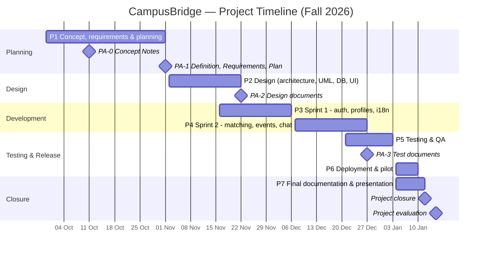

# Project Plan Document

**Project:** CampusBridge — Erasmus & Local Student Matching Platform\
**Course:** BIL 481 Software Engineering — Fall 2026, TOBB ETÜ\
**Assignment:** Project Assignment 1 (PA-1)\
**Group:** Sangre y Oro\
**Version / Date:** 1.0 — 01-11-2026

**Contributors to this document:**

| Full Name | GitHub Username | School Number |
| --- | --- | --- |
| Turgay Samet Şentürk | @turgaysamet | 221104087 |
| Alejandro Blas Piris | @Blas-24 | 261118081 |
| Carlos Molina Perez | @Camope345 | 261118083 |
| Alberto Alvarez Polo | @903155 | 261118082 |

## Table of Contents

1. [Project Scope](#1-project-scope)
2. [Project Organization — People](#2-project-organization--people)
3. [Objectives](#3-objectives)
4. [Key Phases and Timeline](#4-key-phases-and-timeline)
5. [Resource Planning](#5-resource-planning)
6. [Risk Management](#6-risk-management)
7. [Communication Plan](#7-communication-plan)
8. [Change Management Plan](#8-change-management-plan)
9. [Budget Plan](#9-budget-plan)
10. [Effort Estimation](#10-effort-estimation)
11. [Task Assignments](#11-task-assignments)
12. [Document-Specific Task Matrix](#12-document-specific-task-matrix)

## 1. Project Scope

CampusBridge is a responsive web application that connects Erasmus/exchange students with local students of TOBB ETÜ through interest-based matching and shared events. The full list of requirements is given in the Requirements Document (FR-01 – FR-18, NFR-01 – NFR-09).

**Included:** institutional e-mail and invitation-code registration; user profiles; matching with user-controlled filters; match requests; one-to-one messaging; event management; TR/EN/ES interface and on-demand translation of user content; notifications; privacy tools (consent, data export, account deletion); report/block; administration panel; testing and a pilot deployment at TOBB ETÜ.

**Not included:** native mobile apps; real eduroam/eduGAIN federated login (replaced by e-mail verification); integration with official university systems; group chat, voice/video calls; payments; machine-learning recommendations; deployment to other universities.

## 2. Project Organization — People

| Team member | Main role | Secondary role | Responsibilities |
| --- | --- | --- | --- |
| Turgay Samet Şentürk | Project Manager & Requirements Analyst | Backend developer (profiles, privacy) | Planning and tracking, meeting organisation, GitHub Projects board, requirements, KVKK/GDPR compliance, Turkish localisation, contact with local students and the Erasmus office, pilot coordination |
| Alejandro Blas Piris | UI/UX Designer | Frontend developer | Wireframes and prototype (Figma), React frontend, multi-language interface, responsive design, usability |
| Carlos Molina Perez | Backend Developer & DevOps | Database designer | System architecture, database, authentication, events backend, CI/CD with GitHub Actions, cloud deployment and monitoring |
| Alberto Alvarez Polo | Algorithm & Integration Developer | QA / Test Lead | Matching algorithm, translation API integration, test plan, unit/integration/system testing, quality control of documents |

All members take part in requirements, design reviews, code reviews and documentation. Every module has a **backup person** (see Section 11.2) to reduce the risk of a member becoming unavailable.

**Scrum roles.** Because the project follows Scrum, the roles above are mapped to the three Scrum roles:

| Scrum role | Team member | Responsibility in Scrum |
| --- | --- | --- |
| Product Owner | Turgay Samet Şentürk | Owns and prioritises the product backlog, represents the users (local and Erasmus students) and accepts or rejects the work done in each sprint |
| Scrum Master | Alejandro Blas Piris | Facilitates the Scrum events, keeps the time boxes, removes impediments and helps the team follow the process |
| Development Team | All four members | Design, implement and test the backlog items selected for each sprint and estimate their effort |

*Stakeholders* are the course instructor and TA (who evaluate the deliverables), the pilot users and the TOBB ETÜ Erasmus office. In a team of four, the Scrum Master and Product Owner are also developers; we know this is a typical Scrum anti-pattern, so they clearly state in meetings when they speak in their Scrum role, and the Product Owner is the only person who changes backlog priorities.

## 3. Objectives

Objectives for the execution and management of the project:

- **PO1.** Deliver every course assignment (PA-1, PA-2, PA-3, final documentation) on or before its deadline.
- **PO2.** Complete the project within the estimated **300 person-hours** (± 10%) and a budget of **0 TL**.
- **PO3.** Work in **three-week sprints** (Scrum allows sprints of 1–4 weeks), with sprint planning, a sprint review and a sprint retrospective in every sprint.
- **PO4.** Keep the work visible: every task is a GitHub Issue on the project board, every change goes through a pull request reviewed by at least one other member, and commit messages reference the issue (e.g. `FR-06: add compatibility score #23`).
- **PO5.** Keep the workload balanced: the difference in planned effort between members is less than 10%.
- **PO6.** Implement all "Must" requirements before the testing phase starts.
- **PO7.** Close the project with a pilot of at least 50 users and a final evaluation meeting.

## 4. Key Phases and Timeline

The project follows an **Agile approach using Scrum**. We chose Scrum instead of the Waterfall model because the requirements of a new social platform are uncertain and will change with feedback from students, and because Scrum lets us test continuously from the beginning instead of only at the end.

- **Product backlog:** all functional and non-functional requirements (FR/NFR) are product backlog items (PBIs) on the GitHub Projects board, ordered by priority (MoSCoW) and estimated with relative story points (Fibonacci values).
- **Sprint backlog:** at each sprint planning, the team selects the PBIs for the sprint and breaks them into tasks estimated in ideal hours (each task small enough to finish in one working session).
- **Increment and Definition of Done:** a PBI is "done" when its code is merged through a reviewed pull request, its unit tests pass in CI, its acceptance criterion from the Requirements Document is met, and its texts exist in TR/EN/ES.
- **Events (adapted to a student team):** sprint planning, a short "daily scrum" adapted as an asynchronous stand-up three times a week (what I did, what I will do, blockers), sprint review with a demo, and sprint retrospective using the KPT method (Keep – Problem – Try).
- **Metrics:** velocity (story points completed per sprint) and a sprint burndown chart are used to check whether the plan is on schedule.

Phases 1–2 prepare the project; phases 3–4 are the development sprints; phases 5–7 complete, deploy and close the project. Phases partly overlap so that, for example, testing starts while the last features are being finished.

| # | Phase | Start | End | Deliverable / milestone |
| --- | --- | --- | --- | --- |
| P1 | Concept, requirements and planning | 29-09-2026 | 01-11-2026 | Concept Notes (PA-0, 11-10-2026); Project Definition, Requirements and Project Plan (PA-1, **01-11-2026**) |
| P2 | Design (architecture, UML, database, UI) | 02-11-2026 | 22-11-2026 | Design documentation (PA-2, planned 22-11-2026) |
| P3 | Development Sprint 1 — infrastructure, authentication, profiles, i18n | 16-11-2026 | 06-12-2026 | Working login and profile module (internal demo 06-12-2026) |
| P4 | Development Sprint 2 — matching, events, messaging, translation, admin | 07-12-2026 | 27-12-2026 | Feature-complete beta (27-12-2026) |
| P5 | Testing and quality assurance | 21-12-2026 | 03-01-2027 | Test report (PA-3, planned 27-12-2026); all critical bugs fixed |
| P6 | Deployment and pilot | 04-01-2027 | 10-01-2027 | Pilot online for TOBB ETÜ students (10-01-2027) |
| P7 | Final documentation and presentation | 04-01-2027 | 12-01-2027 | Final report, user guide, presentation (12-01-2027) |
| — | **Project closure** | | **12-01-2027** | Final delivery of code and documents |
| — | **Project evaluation** | | **15-01-2027** | Evaluation meeting: success criteria, pilot metrics, lessons learned |

*The dates of PA-2, PA-3 and the final presentation are our planning estimates; they will be updated through the change management process when the official dates are announced.*

### Gantt Chart

## 5. Resource Planning

| Resource | Use in the project | How it is accessed |
| --- | --- | --- |
| Team members (4) | Analysis, design, development, testing | ≈ 6 h per week each (see Section 10) |
| Personal laptops | Development | Owned by team members |
| GitHub repository, Issues, Projects, Actions | Version control, task board, CI | Group repository (free, GitHub Student) |
| Java 21, Spring Boot, Spring Security, JPA/Hibernate | Backend REST API | Open source (Maven) |
| React, TypeScript, i18next | Frontend and translations of the interface | Open source (npm) |
| PostgreSQL | Database | Open source; Docker container locally, managed free-tier database in the cloud |
| Docker | Same environment for all developers and for deployment | Free |
| Cloud hosting (Render / Railway free tier or GitHub Student Developer Pack credits) | Pilot deployment | Free account of the group |
| DeepL API Free (backup: Google Cloud Translation free tier) | Translation of user-generated content (FR-13) | API key of the group account |
| E-mail service free tier (e.g. Brevo) | Verification and password-reset e-mails | API key of the group account |
| JUnit 5, Mockito, JaCoCo, Jest | Unit testing with mocks and code coverage measurement | Open source / free |
| Selenium WebDriver, Postman, k6/JMeter, OWASP ZAP | Web UI (system) testing, API testing, load testing, security testing | Open source / free |
| Figma | Wireframes and prototype | Free education plan |
| Google Drive | Shared documents and final PDFs | Group Drive folder `BIL481-2026-Project` |

## 6. Risk Management

| # | Risk | Prob. | Impact | Mitigation | Owner |
| --- | --- | --- | --- | --- | --- |
| R1 | Technical difficulties / lack of experience with the stack | Medium | High | Learning tasks in P2, pair programming, simple and well-documented technologies, early prototype | Carlos |
| R2 | Delays because of exams and other courses | High | Medium | Two-week sprints, MoSCoW priorities ("Must" first), buffer at the end of each phase, weekly progress check | Turgay |
| R3 | Team member leaves or is unavailable | Low | High | Backup person for every module, code reviews, documentation in the repository; if we fall behind, we reduce scope ("Could"/"Should" items) instead of adding people late (Brooks' law) | Turgay |
| R4 | Data protection problem (GDPR/KVKK) | Low | High | Privacy-by-Design, minimal data, HTTPS, hashing, security scan before pilot | Turgay |
| R5 | External service limits (translation API, hosting) | Low | Medium | Caching, on-demand translation, usage monitoring, backup provider | Alberto |
| R6 | Not enough pilot users | Medium | High | Promotion through Erasmus office, clubs and social media starting in December | Turgay |
| R7 | Scope creep | Medium | Medium | Change management process (Section 8) | Turgay |
| R8 | Integration problems between frontend and backend | Medium | Medium | API contract (OpenAPI) defined in P2, continuous integration, weekly integration | Carlos |

Risks are reviewed at each sprint planning meeting and the table is updated in the repository.

## 7. Communication Plan

| Channel | Purpose | Frequency |
| --- | --- | --- |
| Weekly team meeting (in person on campus or Google Meet, ~45 min) | Progress, problems, next tasks; short minutes saved in `docs/meetings/` | Every week |
| Daily scrum (asynchronous stand-up in the WhatsApp group) | Each member writes: what I did, what I will do, blockers | Monday, Wednesday, Friday |
| Sprint planning, sprint review and retrospective (KPT) | Choose sprint backlog, demo results, improvements | Every sprint (3 weeks) |
| WhatsApp group | Quick daily questions and coordination | Daily, as needed |
| GitHub Issues, Projects board and pull requests | Task assignment, technical discussion, code review, official decisions | Continuous |
| Google Drive | Shared drafts and final PDFs | Continuous |
| Piazza / e-mail / TA office hours | Questions to the course staff (instructor and TA) | As needed |
| Erasmus office and student clubs (contact: Turgay) | Pilot promotion and user feedback | From December, as needed |

The working language of the team is **English**. Decisions taken in WhatsApp or meetings are written in a GitHub Issue so that they are traceable.

## 8. Change Management Plan

Following the Agile principle of *welcoming changing requirements*, changes are allowed, but they are controlled through the product backlog, which is the only source of changes in the project:

1. **Request:** any member (or stakeholder feedback) opens a GitHub Issue with the label `change-request`, describing the change and the reason.
2. **Impact analysis:** the Project Manager and the owner of the affected module estimate the effect on requirements, effort (person-hours), schedule and risks.
3. **Decision:** the change is discussed at the next weekly meeting or backlog refinement. The Product Owner decides whether it enters the product backlog and with which priority. Small changes (< 4 person-hours, no effect on deadlines) can be approved directly by the Product Owner; larger changes need the agreement of the majority of the team. Changes that would damage the goal of the current sprint wait until the next sprint planning, and changes that affect a "Must" requirement or a deadline are avoided after the start of P5.
4. **Update:** if approved, the Requirements Document, this plan and the project board are updated, and the document version number is increased (e.g. 1.0 → 1.1) with a short change log.
5. **Implementation and verification:** the change is implemented in a pull request that references the change-request issue and is tested before merging.

## 9. Budget Plan

The monetary budget is **0 TL** (free and open-source tools; see the Project Definition Document, Section 8). The main resource of the project is the **team's effort**, which is allocated to phases as follows:

| Phase | Person-hours | Share of total effort |
| --- | ---: | ---: |
| P1 Concept, requirements and planning | 40 | 13.3% |
| P2 Design | 48 | 16.0% |
| P3 Development Sprint 1 | 64 | 21.3% |
| P4 Development Sprint 2 | 72 | 24.0% |
| P5 Testing and QA | 36 | 12.0% |
| P6 Deployment and pilot | 16 | 5.3% |
| P7 Final documentation and presentation | 24 | 8.0% |
| **Total planned effort** | **300** | **100%** |
| Contingency reserve (10%) | 30 | — |

About **45%** of the effort goes to development, **12%** to testing and **43%** to analysis, design, deployment and documentation. The contingency reserve of 30 person-hours is used only when a risk occurs (e.g. delays or bug fixing) and its use is recorded at the weekly meeting. If extra paid services become necessary (e.g. the translation API exceeds its free limit), the cost is shared equally by the team members, with a maximum of 10 USD per month.

## 10. Effort Estimation

### 10.1 Estimation Method

We used **expert judgment with a bottom-up approach**:

1. The project was divided into phases and tasks (work breakdown structure), with the development tasks mapped to the functional requirements.
2. Each task was estimated in a **Planning Poker** session (Scrum, as seen in class): every member gave an estimate in ideal hours using Fibonacci-like values (1, 2, 3, 5, 8, 13…), we discussed big differences and agreed on one value.
3. We compared the result with our experience from similar course projects (**analogy**) and the available time: 4 members × ≈ 6 hours/week × ≈ 13 weeks ≈ 310 hours, which matches the estimate of 300 person-hours.
4. A **10% contingency** reserve (30 person-hours) was added for uncertainty.

Weekly meetings and code reviews are included in the task estimates.

### 10.2 Effort per Phase and Task (person-hours)

Abbreviations: **TS** = Turgay Samet Şentürk, **AB** = Alejandro Blas Piris, **CM** = Carlos Molina Perez, **AA** = Alberto Alvarez Polo.

| ID | Task | Related req. | Responsible | TS | AB | CM | AA | Total |
| --- | --- | --- | --- | ---: | ---: | ---: | ---: | ---: |
| **P1** | **Concept, requirements and planning** | | | **13** | **9** | **9** | **9** | **40** |
| 1.1 | Concept Notes (PA-0) | — | TS | 4 | 4 | 4 | 4 | 16 |
| 1.2 | Project Definition Document | — | TS | 4 | 2 | 2 | 2 | 10 |
| 1.3 | Requirements Document | All FR/NFR | AA | 2 | 2 | 2 | 3 | 9 |
| 1.4 | Project Plan and effort estimation | — | TS | 3 | 1 | 1 | 0 | 5 |
| **P2** | **Design** | | | **10** | **16** | **12** | **10** | **48** |
| 2.1 | System architecture, API contract, technology set-up | NFR-02, NFR-08 | CM | 2 | 2 | 6 | 2 | 12 |
| 2.2 | UML diagrams (use case, class, sequence) | All FR | TS | 4 | 2 | 2 | 4 | 12 |
| 2.3 | Database schema design | FR-01–FR-18 | CM | 0 | 0 | 4 | 0 | 4 |
| 2.4 | UI/UX wireframes and Figma prototype | FR-04–FR-14, NFR-04 | AB | 1 | 12 | 0 | 1 | 14 |
| 2.5 | Matching algorithm design (scoring formula) | FR-06, FR-07 | AA | 1 | 0 | 0 | 3 | 4 |
| 2.6 | PA-2 document compilation | — | TS | 2 | 0 | 0 | 0 | 2 |
| **P3** | **Development Sprint 1** | | | **14** | **20** | **22** | **8** | **64** |
| 3.1 | Project set-up, Docker, CI pipeline | NFR-08 | CM | 0 | 0 | 6 | 0 | 6 |
| 3.2 | Database implementation (entities, migrations) | — | CM | 0 | 0 | 8 | 0 | 8 |
| 3.3 | Registration, invitation codes, login, password reset | FR-01, FR-02, FR-03 | CM | 0 | 0 | 8 | 0 | 8 |
| 3.4 | Profile pages and forms (frontend) | FR-04, FR-05 | AB | 0 | 12 | 0 | 0 | 12 |
| 3.5 | Multi-language interface (TR/EN/ES) | FR-14, NFR-06 | AB | 0 | 8 | 0 | 0 | 8 |
| 3.6 | Profile backend and interest catalogue | FR-04, FR-05 | TS | 8 | 0 | 0 | 0 | 8 |
| 3.7 | Consent, data export, account deletion | FR-16, NFR-03 | TS | 6 | 0 | 0 | 0 | 6 |
| 3.8 | Unit tests for authentication and profiles | NFR-08 | AA | 0 | 0 | 0 | 8 | 8 |
| **P4** | **Development Sprint 2** | | | **15** | **17** | **14** | **26** | **72** |
| 4.1 | Matching algorithm and filters (backend) | FR-06, FR-07, FR-08 | AA | 0 | 0 | 0 | 18 | 18 |
| 4.2 | Translation API integration with cache | FR-13 | AA | 0 | 0 | 0 | 8 | 8 |
| 4.3 | Event pages: create, browse, join (frontend) | FR-09, FR-10, FR-11 | AB | 0 | 12 | 0 | 0 | 12 |
| 4.4 | Match suggestions and requests (frontend) | FR-06, FR-07, FR-08 | AB | 0 | 5 | 0 | 0 | 5 |
| 4.5 | Events backend and notifications | FR-09, FR-10, FR-11, FR-15 | CM | 0 | 0 | 14 | 0 | 14 |
| 4.6 | One-to-one messaging | FR-12 | TS | 9 | 0 | 0 | 0 | 9 |
| 4.7 | Report/block and administration panel | FR-17, FR-18 | TS | 6 | 0 | 0 | 0 | 6 |
| **P5** | **Testing and QA** | | | **9** | **6** | **6** | **15** | **36** |
| 5.1 | Test plan and test cases | All FR/NFR | AA | 2 | 0 | 0 | 6 | 8 |
| 5.2 | Integration, system, performance and security testing | NFR-01, NFR-02, NFR-05 | AA | 0 | 2 | 4 | 6 | 12 |
| 5.3 | Bug fixing | — | AB | 1 | 4 | 2 | 1 | 8 |
| 5.4 | Usability test and user acceptance test with students | NFR-04 | TS | 6 | 0 | 0 | 2 | 8 |
| **P6** | **Deployment and pilot** | | | **4** | **2** | **8** | **2** | **16** |
| 6.1 | Production deployment, backups, monitoring | NFR-07 | CM | 0 | 0 | 8 | 0 | 8 |
| 6.2 | Pilot launch and promotion | — | TS | 4 | 2 | 0 | 2 | 8 |
| **P7** | **Final documentation and presentation** | | | **10** | **5** | **4** | **5** | **24** |
| 7.1 | Final report and user guide | — | TS | 6 | 3 | 2 | 3 | 14 |
| 7.2 | Presentation and demo | — | TS | 4 | 2 | 2 | 2 | 10 |
| | **TOTAL** | | | **75** | **75** | **75** | **75** | **300** |

### 10.3 Total Effort per Person

| Team member | Role | Planned effort | Share |
| --- | --- | ---: | ---: |
| Turgay Samet Şentürk | Project Manager & Requirements Analyst | 75 h | 25% |
| Alejandro Blas Piris | UI/UX Designer & Frontend Developer | 75 h | 25% |
| Carlos Molina Perez | Backend Developer & DevOps | 75 h | 25% |
| Alberto Alvarez Polo | Algorithm & Integration Developer, QA Lead | 75 h | 25% |
| **Total** | | **300 h** | **100%** |

### 10.4 Total Project Effort

Total project effort = 40 + 48 + 64 + 72 + 36 + 16 + 24 = **300 person-hours** (≈ 37.5 person-days of 8 hours). Including the 10% contingency reserve, the maximum planned effort is **330 person-hours**.

## 11. Task Assignments

### 11.1 Team Members and Roles

| Team member | Roles in the project |
| --- | --- |
| Turgay Samet Şentürk | Project manager, requirements analyst, backend developer (profiles, privacy, messaging, admin), pilot coordinator |
| Alejandro Blas Piris | UI/UX designer, frontend developer, localisation of the interface |
| Carlos Molina Perez | Software architect, backend developer (database, authentication, events), DevOps |
| Alberto Alvarez Polo | Algorithm developer (matching), integration developer (translation API), tester / QA lead |

### 11.2 Task Matrix (Phases and Functional Requirements)

R = Responsible, S = Support / backup, — = not involved.

| Phase / Requirement | TS | AB | CM | AA |
| --- | :---: | :---: | :---: | :---: |
| P1 Concept, requirements, planning | R | S | S | S |
| P2 Design | S | R (UI) | R (architecture, DB) | S |
| P5 Testing and QA | S | S | S | R |
| P6 Deployment and pilot | R (pilot) | — | R (deployment) | S |
| P7 Final documentation and presentation | R | S | S | S |
| FR-01 Registration with institutional e-mail | — | S | R | S |
| FR-02 Registration with invitation code | S | — | R | — |
| FR-03 Login, logout, password reset | — | S | R | — |
| FR-04 Create profile | R (backend) | R (frontend) | — | — |
| FR-05 View and edit profile | R (backend) | R (frontend) | — | — |
| FR-06 Match suggestions | — | S (frontend) | — | R |
| FR-07 Matching filters | — | S (frontend) | — | R |
| FR-08 Match requests | — | S (frontend) | — | R |
| FR-09 Create event | — | R (frontend) | R (backend) | — |
| FR-10 Browse and search events | — | R (frontend) | R (backend) | — |
| FR-11 Join and leave events | — | R (frontend) | R (backend) | — |
| FR-12 Messaging | R | S | — | — |
| FR-13 Translation of user content | — | S | — | R |
| FR-14 Multi-language interface | S (Turkish texts) | R | — | S (Spanish texts) |
| FR-15 Notifications | — | S | R | — |
| FR-16 Consent and data rights | R | — | S | — |
| FR-17 Report and block users | R | S | — | — |
| FR-18 Administration panel | R | — | S | — |

### 11.3 Rationale for Task Assignment

- **Skills:** Carlos has the strongest interest and experience in Java and back-end development, so he leads architecture, database and authentication. Alejandro is interested in design and user experience, so he leads the UI and frontend. Alberto is interested in algorithms and quality, so he owns the matching logic, the external API integration and testing. Turgay, as the only local (Turkish) member, is the natural contact with local students, the Erasmus office and KVKK aspects, and leads project management and requirements.
- **Interests and learning objectives:** each member also has a secondary role outside their comfort zone (e.g. Turgay does backend features, Alberto writes Spanish texts and tests, Alejandro joins bug fixing and testing) so that everyone learns the full development process.
- **Fairness:** the planned effort is exactly 75 person-hours per member (Section 10.3). Members with lighter development work (Turgay) carry the management, documentation and pilot coordination load.
- **Effectiveness:** every functional requirement has one clear responsible person and every module has a backup person, which reduces dependency on a single member and supports code reviews.
- **Clarity of contribution on GitHub:** each task is a GitHub Issue assigned to its responsible member; members work on feature branches named after the requirement (e.g. `feature/FR-06-matching`), commit with their own GitHub accounts using clear messages that reference the requirement and issue, and merge through reviewed pull requests. The repository is organised by module (`backend/`, `frontend/`, `docs/`) so individual contributions are easy to see.

## 12. Document-Specific Task Matrix

| Task in the creation of this document | Responsible | Support |
| --- | --- | --- |
| Project scope | Turgay Samet Şentürk | Alberto Alvarez Polo |
| Project organisation and roles | Turgay Samet Şentürk | All members |
| Objectives | Turgay Samet Şentürk | Carlos Molina Perez |
| Phases, timeline and Gantt chart | Alejandro Blas Piris | Turgay Samet Şentürk |
| Resource planning | Carlos Molina Perez | Alejandro Blas Piris |
| Risk management | Alberto Alvarez Polo | Turgay Samet Şentürk |
| Communication plan | Alejandro Blas Piris | Turgay Samet Şentürk |
| Change management plan | Carlos Molina Perez | Turgay Samet Şentürk |
| Budget plan | Carlos Molina Perez | Alberto Alvarez Polo |
| Effort estimation (Planning Poker session) | Alberto Alvarez Polo | All members |
| Task assignments and rationale | Turgay Samet Şentürk | All members |
| Review, formatting and PDF conversion | Carlos Molina Perez | All members |
