# Design Document

**Project:** CampusBridge — Erasmus & Local Student Matching Platform\
**Course:** BIL 481 Software Engineering — Fall 2026, TOBB ETÜ\
**Assignment:** Project Assignment 2 (PA-2) — Design and Quality Assurance\
**Group:** Sangre y Oro\
**Version / Date:** 1.0 — 15-11-2026

**List of contributors:**

| Full Name | GitHub Username | School Number | Main contribution to this document |
| --- | --- | --- | --- |
| Turgay Samet Şentürk | @turgaysamet | 221104087 | System overview, use case selection and mapping, UC-1 and UC-2 design |
| Alejandro Blas Piris | @Blas-24 | 261118081 | Visual interfaces, frontend structure, UC-4 design, frontend comparison |
| Carlos Molina Perez | @Camope345 | 261118083 | Architecture, technology stack, codebase structure, REST API, data model, backend and database comparisons |
| Alberto Alvarez Polo | @903155 | 261118082 | Matching algorithm, component interfaces, UC-3 design, design decision justifications |

<div class="page-break"></div>

## Table of Contents

1. [System Overview](#1-system-overview)
   1. [Brief Project Description](#11-brief-project-description)
   2. [System Architecture](#12-system-architecture)
   3. [Technology Stack](#13-technology-stack)
2. [Implementation Details](#2-implementation-details)
   1. [Codebase Structure](#21-codebase-structure)
   2. [Key Implementations](#22-key-implementations)
   3. [Component Interfaces](#23-component-interfaces)
   4. [Data Model](#24-data-model)
   5. [Visual Interfaces](#25-visual-interfaces)
3. [Use Case Support in Design](#3-use-case-support-in-design)
   1. [Use Case Selection](#31-use-case-selection)
   2. [Requirement Mapping](#32-requirement-mapping)
   3. [UC-1: Register and Log In](#33-uc-1-register-and-log-in)
   4. [UC-2: Create and Edit Profile](#34-uc-2-create-and-edit-profile)
   5. [UC-3: Get Match Suggestions and Send a Match Request](#35-uc-3-get-match-suggestions-and-send-a-match-request)
   6. [UC-4: Create and Join an Event](#36-uc-4-create-and-join-an-event)
   7. [Demo Requirement](#37-demo-requirement)
4. [Design Decisions](#4-design-decisions)
   1. [Technology Comparisons](#41-technology-comparisons)
   2. [Decision Justifications](#42-decision-justifications)
5. [GitHub Commit Requirement](#5-github-commit-requirement)
6. [Document-Specific Task Matrix](#6-document-specific-task-matrix)

<div class="page-break"></div>

## 1. System Overview

### 1.1 Brief Project Description

CampusBridge is a responsive web application that helps Erasmus and exchange students at TOBB ETÜ meet local students. Instead of grouping people by nationality, the platform matches students according to their **shared interests, skills and complementary language goals** (for example, a Spanish student who wants to practise Turkish and a Turkish student who wants to practise Spanish). Students can also create and join real-life activities such as football matches, language tandems or cultural visits.

The goals of the system, as defined in the Project Definition Document (PA-1), are to give verified members of the university a safe way to connect, to support Turkish, English and Spanish, and to protect personal data according to GDPR and KVKK. This document explains how the system is designed and implemented around four core use cases: registration, profile creation, matching, and events.

### 1.2 System Architecture

CampusBridge uses a **client–server architecture** with a **layered monolithic backend**:

- The **client** is a single-page application (React) running in the browser. It only talks to the backend through a JSON REST API.
- The **backend** is one Spring Boot application divided into four **layers**. Each layer only calls the layer directly below it:
  1. **Presentation layer (controllers)** — receives HTTP requests, validates the input (Bean Validation) and converts objects to JSON.
  2. **Business layer (services + domain entities)** — contains the business rules of the requirements (e.g. "at most 5 active invitation codes", "an event cannot exceed its capacity").
  3. **Data access layer (repositories)** — Spring Data JPA interfaces that read and write the database.
  4. **Database** — PostgreSQL.
- Inside the backend, the code is also divided **by feature module** (`auth`, `profile`, `matching`, `event`), so each team member can work on one module with few conflicts.
- **External services** (verification e-mail, translation API) are accessed through small interfaces (`EmailSender`, `NotificationPublisher`), so they can be replaced by fake implementations in development and tests.

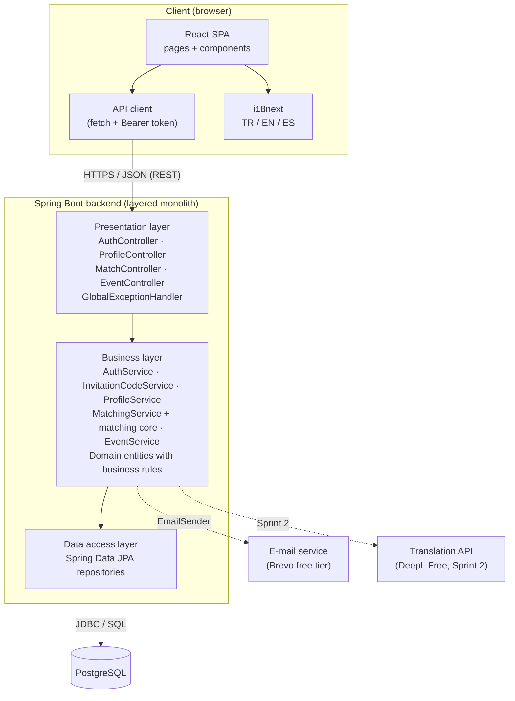

*Figure 1 — System architecture.*

**Deployment view.** In the pilot, the frontend is built as static files and the backend runs as a Docker container on a cloud free tier (e.g. Render). The database is a managed PostgreSQL instance in an EU region (NFR-03). GitHub Actions builds and tests every commit (see the QA Plan).

### 1.3 Technology Stack

| Layer | Technology | Version | Purpose |
| --- | --- | --- | --- |
| Frontend | React | 18.3 | Single-page user interface |
| Frontend | TypeScript | 5.6 | Static types for components and API DTOs |
| Frontend | Vite | 5.4 | Development server and production build |
| Frontend | React Router | 6.28 | Navigation between pages |
| Frontend | i18next / react-i18next | 23 / 15 | Turkish, English and Spanish texts (FR-14, NFR-06) |
| Backend | Java | 21 (LTS) | Programming language |
| Backend | Spring Boot (Web, Data JPA, Validation) | 3.3 | REST API, dependency injection, transactions |
| Backend | Hibernate (via Spring Data JPA) | 6.5 | Object-relational mapping |
| Backend | Spring Security Crypto (BCrypt) | 6.3 | Password hashing (NFR-02) |
| Database | PostgreSQL | 16 | Main relational database |
| Database | H2 (PostgreSQL mode) | 2.x | In-memory database for integration tests |
| Testing | JUnit 5, Mockito, AssertJ, JaCoCo | — | Backend unit tests and coverage |
| Testing | Vitest | 2.1 | Frontend unit tests |
| Testing | Selenium WebDriver, Postman, k6, OWASP ZAP | — | System, API, load and security tests (QA Plan) |
| DevOps | Maven, npm, Docker, GitHub Actions | — | Build, packaging and continuous integration |
| External | Brevo (e-mail), DeepL API Free (translation) | — | Verification e-mails, translation of user content |

## 2. Implementation Details

### 2.1 Codebase Structure

The repository is a **monorepo**: backend, frontend, documentation and comparison snippets are in the same GitHub repository, so one pull request can change the API and the screen that uses it.

```text
BIL481-2026-Project/
├── backend/                         Spring Boot REST API (Maven)
│   ├── pom.xml
│   └── src/
│       ├── main/java/com/campusbridge/
│       │   ├── CampusBridgeApplication.java
│       │   ├── common/              exceptions, error handler, Clock, NotificationPublisher
│       │   ├── auth/                UC-1: User, InvitationCode, AuthService, AuthController
│       │   │   └── dto/
│       │   ├── profile/             UC-2: Profile, Interest, ProfileService, ProfileController
│       │   │   └── dto/
│       │   ├── matching/            UC-3: MatchRequest, MatchingService, MatchController
│       │   │   ├── core/            framework-free matching algorithm (no Spring/JPA imports)
│       │   │   └── dto/
│       │   └── event/               UC-4: Event, EventParticipation, EventService, EventController
│       │       └── dto/
│       ├── main/resources/application.yml
│       └── test/java/com/campusbridge/   unit tests (same package structure)
├── frontend/                        React + TypeScript SPA (Vite)
│   └── src/
│       ├── api/                     typed API client: types.ts, authApi, profileApi, matchingApi, eventsApi
│       ├── pages/                   RegisterPage, LoginPage, ProfilePage, MatchesPage, EventsPage
│       ├── components/              reusable components (ErrorMessage)
│       ├── i18n/                    i18next set-up + locales/{tr,en,es}.json
│       └── App.tsx, main.tsx, styles.css
├── tech-comparison/                 code snippets for Section 4 (backend, database, frontend)
├── docs/
│   ├── Concept_Notes.pdf            PA-0
│   ├── PA-1/                        Project Definition, Requirements, Project Plan
│   └── PA-2/                        this document, QA Plan, screenshots/
└── .github/                         CI workflow, bug report template, pull request template
```

Inside every backend module the same pattern is used: **Controller → Service → Repository**, plus the **entities** and the **dto** sub-package. DTOs (Java `record`s) are the only objects sent over the network, so database entities (with fields such as `passwordHash`) are never exposed.

### 2.2 Key Implementations

#### 2.2.1 Authentication module (`auth`) — UC-1

- **`AuthServiceImpl`** registers users, verifies e-mails, logs users in and creates invitation codes.
- **Eligibility rule (FR-01/FR-02):** an e-mail ending in `@etu.edu.tr` is accepted directly (`EmailDomainPolicy`); any other e-mail needs a valid invitation code and the user type `ERASMUS`.
- **Verification:** a random UUID token is stored in the user with an expiry of 24 hours; the account stays `PENDING_VERIFICATION` until `User.verify(token, now)` succeeds.
- **Brute-force protection (FR-03):** `User.registerFailedLogin()` locks the account for 15 minutes after 5 wrong passwords. The login method is annotated with `@Transactional(noRollbackFor = BusinessRuleException.class)` so that the failed-attempt counter is saved even though the request fails.
- **`InvitationCodeService`** generates 8-character codes with `SecureRandom` from an alphabet without ambiguous characters (no `0/O`, `1/I`), checks the limit of 5 active codes and the 14-day validity, and marks codes as used.
- **Passwords** are hashed with BCrypt (NFR-02). Access tokens are issued by a `TokenService` interface; the current in-memory implementation will be replaced by JWT in Sprint 1 without changing any other class.

#### 2.2.2 Profile module (`profile`) — UC-2

- **`Profile`** stores the public data, interests (many-to-many with the `Interest` catalogue), skills, spoken languages with CEFR level (`SpokenLanguage` embeddable) and the languages to practise.
- **Completeness rule (FR-04):** `Profile.update(...)` sets `completed = true` only if there are at least 3 interests and 1 spoken language. Only complete profiles can receive or send matches.
- **Privacy (FR-05, NFR-03):** `ProfileService.toResponse(profile, owner)` fills `gender` only for the owner, and the DTO has no e-mail field at all.
- **`InterestCatalogSeeder`** loads a default catalogue on first start-up so the demo works with an empty database.

#### 2.2.3 Matching module (`matching`) — UC-3 — core algorithm

The algorithm is implemented in the `matching.core` package **without any Spring or JPA dependency**, so it can be unit-tested in milliseconds and reasoned about in isolation. `MatchingService` (business layer) loads data from the database, converts it to `CandidateProfile` objects and calls the core.

**Compatibility score (FR-06)** — `CompatibilityCalculator.score(a, b)`:

```text
total = round( 100 × ( 0.40 × interestScore + 0.20 × skillScore + 0.40 × languageScore ) )

interestScore = |interestsA ∩ interestsB| / |interestsA ∪ interestsB|      (Jaccard index)
skillScore    = |skillsA ∩ skillsB|       / |skillsA ∪ skillsB|            (Jaccard, case-insensitive)
languageScore = ( exchange(A→B) + exchange(B→A) ) / 2
exchange(X→Y) = 1 if X speaks, at level B1 or higher, a language Y wants to practise; otherwise 0
```

- The **Jaccard index** was chosen because it does not favour users who simply select many interests: the score is relative to the size of both sets.
- Languages and interests have the same weight (0.40) because language practice is one of the main reasons students use the platform; skills (0.20) are a secondary signal.
- Nationality is **never** an input (FR-06).

*Example:* Alberto (interests {Football, Language exchange, Live music, Hiking}, speaks ES C2, wants TR) and Elif (interests {Football, Language exchange, Live music}, speaks TR C2, wants ES). interestScore = 3/4 = 0.75, skillScore = 0, languageScore = (1+1)/2 = 1 → total = round(100 × (0.30 + 0 + 0.40)) = **70**.

**Suggestion pipeline** — `MatchSuggestionEngine.suggest(...)`:

```text
function suggest(requester, candidates, excludedIds, filters, limit = 10):
    result = []
    for each c in candidates:
        if c == requester or c.userId in excludedIds: skip          // already matched / pending / declined < 30 days
        if not MatchFilterPolicy.accepts(requester, c, filters): skip // FR-07 filters
        score = CompatibilityCalculator.score(requester, c)
        if score.total > 0: result.add((c, score))
    sort result by total DESC, then interestScore DESC, then userId ASC   // deterministic order
    return first `limit` elements
```

The complexity is O(n·k + n log n) for *n* candidates and *k* items per profile, which is fast for a university-sized user base (thousands of users). If the platform grows, candidates can be pre-filtered in SQL (see `tech-comparison/database/postgresql/match_candidates.sql`).

**Filters (FR-07)** — `MatchFilterPolicy`: *same gender only* (both genders must be stated and equal), *target language* (candidate speaks it at B1+), *interest category* and *user type*. The filters chosen by the user are saved in the profile (`MatchPreferences` embeddable) and reused next time.

**Match requests (FR-08)** follow a small **state machine** implemented in `MatchRequestStatus.allowedNext()` and enforced in `MatchRequest.transitionTo(...)` (Section 3.5).

#### 2.2.4 Event module (`event`) — UC-4

- **`Event`** validates its own invariants in the constructor (date in the future, capacity 2–100) and in `addParticipant()` / `removeParticipant()` (no joining when full, cancelled or started). This is a *rich domain model*: business rules are next to the data they protect.
- **Concurrency:** `Event` has a `@Version` field (optimistic locking). If two students try to take the last place at the same time, one transaction fails instead of exceeding the capacity. `EventParticipation` has a unique constraint `(event_id, user_id)` so nobody can join twice.
- **Search (FR-10):** the repository query uses only non-null parameters (date range and keyword); category and language filters are applied in the service. This avoids a known PostgreSQL problem with untyped `null` parameters.
- **Cancellation (FR-09):** `EventService.cancel()` notifies every participant through `NotificationPublisher`.

#### 2.2.5 Cross-cutting implementations

- **`GlobalExceptionHandler`** converts `NotFoundException` → 404, `BusinessRuleException` → 409 and validation errors → 400, always with the same JSON body `ApiError {status, code, message, timestamp}`. The frontend shows `message` to the user and can react to `code`.
- **`Clock` injection:** every time-dependent rule receives a `java.time.Clock`, so tests use a fixed date (e.g. "the code expired one minute ago").
- **`CurrentUserProvider`:** controllers never read HTTP headers themselves; they ask this interface for the current user id, which makes them easy to test.
- **Frontend API client (`api/client.ts`)** adds the JSON headers and the Bearer token to each request and throws a typed `ApiRequestError`. All browser-storage access is wrapped in `try/catch`.
- **Internationalisation:** every text in the UI comes from `i18n/locales/{tr,en,es}.json`. An automated test checks that the three files have exactly the same keys (NFR-06).

### 2.3 Component Interfaces

#### 2.3.1 Class/method signatures of key components

```java
// ---------- auth ----------
public interface AuthService {
    RegisterResponse register(RegisterRequest request);          // FR-01, FR-02
    void verifyEmail(String token);                               // FR-01
    AuthResponse login(LoginRequest request);                     // FR-03
    InvitationCodeResponse createInvitationCode(Long userId);     // FR-02
}
public class InvitationCodeService {
    public InvitationCode generate(User creator);                 // max 5 active, 14 days
    public void consume(String code, User newUser);
}
public interface EmailSender   { void sendVerificationEmail(String to, String verificationLink); }
public interface TokenService  { String issueToken(User user); Optional<Long> resolveUserId(String token); }

// ---------- profile ----------
public class ProfileService {
    public ProfileResponse saveOwnProfile(Long userId, ProfileRequest request);   // FR-04, FR-05
    public ProfileResponse getOwnProfile(Long userId);
    public ProfileResponse getPublicProfile(Long userId);                         // hides gender / e-mail
    public List<InterestDto> getInterestCatalogue();
}

// ---------- matching ----------
public class MatchingService {
    public List<SuggestionResponse> getSuggestions(Long userId, MatchFilters filters);  // FR-06, FR-07
    public void savePreferences(Long userId, MatchPreferencesDto preferences);          // FR-07
    public MatchRequestResponse sendRequest(Long senderId, Long receiverId);            // FR-08
    public MatchRequestResponse respond(Long requestId, Long userId, boolean accept);   // FR-08
    public List<MatchRequestResponse> getIncomingRequests(Long userId);
    public List<MatchRequestResponse> getMatches(Long userId);
    public void removeMatch(Long requestId, Long userId);
}
// framework-free core
public class CompatibilityCalculator { public ScoreBreakdown score(CandidateProfile a, CandidateProfile b); }
public class MatchFilterPolicy { public boolean accepts(CandidateProfile requester, CandidateProfile c, MatchFilters f); }
public class MatchSuggestionEngine {
    public List<MatchSuggestion> suggest(CandidateProfile requester, Collection<CandidateProfile> candidates,
                                         Set<Long> excludedUserIds, MatchFilters filters, int limit);
}

// ---------- event ----------
public class EventService {
    public EventResponse create(Long creatorId, CreateEventRequest request);                     // FR-09
    public List<EventResponse> search(Long viewerId, EventCategory category, Instant from,
                                      Instant to, String language, String keyword);              // FR-10
    public EventResponse get(Long viewerId, Long eventId);
    public EventResponse join(Long userId, Long eventId);                                        // FR-11
    public EventResponse leave(Long userId, Long eventId);                                       // FR-11
    public EventResponse cancel(Long userId, Long eventId);                                      // FR-09
}

// ---------- common ----------
public interface CurrentUserProvider    { Long currentUserId(); }
public interface NotificationPublisher  { void notifyUser(Long userId, String type, String message); }
```

The same DTOs are mirrored in TypeScript in `frontend/src/api/types.ts`, which is the **contract** between frontend and backend.

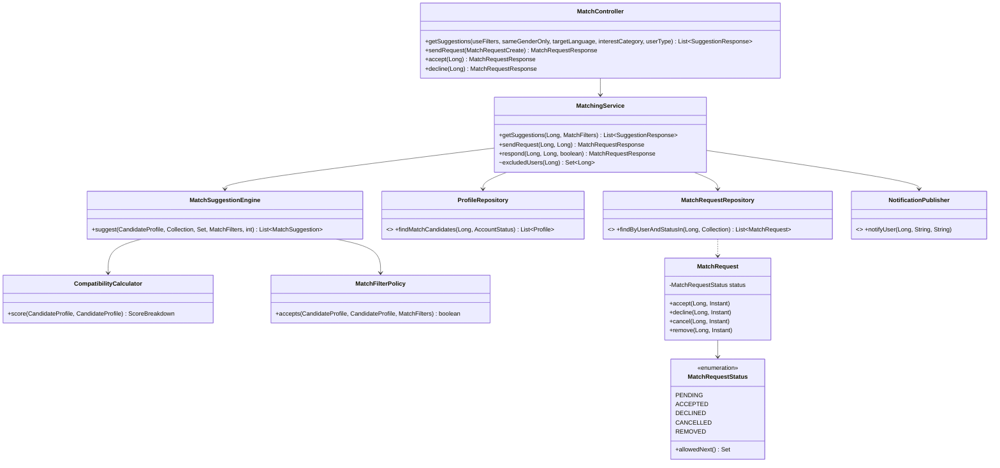

*Figure 2 — Class diagram of the matching component (other modules follow the same structure).*

#### 2.3.2 REST API endpoints

All endpoints are under `/api`, use JSON, and (except registration, verification and login) require the header `Authorization: Bearer <token>`. Errors return `ApiError {status, code, message, timestamp}`. The fields of each DTO are listed in Section 2.3.1 and in `frontend/src/api/types.ts`.

| Method | Endpoint | Request | Response | Use case / requirements |
| --- | --- | --- | --- | --- |
| POST | `/auth/register` | `RegisterRequest` | 201 `RegisterResponse` | UC-1 / FR-01, FR-02, FR-16 |
| GET | `/auth/verify?token=` | token from e-mail | 204 | UC-1 / FR-01 |
| POST | `/auth/login` | `LoginRequest` | 200 `AuthResponse` (token) | UC-1 / FR-03 |
| POST | `/auth/invitation-codes` | — | 201 `InvitationCodeResponse` | UC-1 / FR-02 |
| GET | `/interests` | — | 200 `InterestDto[]` | UC-2 / FR-04 |
| GET | `/profiles/me` | — | 200 `ProfileResponse` (with gender) | UC-2 / FR-05 |
| PUT | `/profiles/me` | `ProfileRequest` | 200 `ProfileResponse` | UC-2 / FR-04, FR-05 |
| GET | `/profiles/{userId}` | — | 200 `ProfileResponse` (no gender, no e-mail) | UC-2 / FR-05 |
| GET | `/matches/suggestions` | query: `useFilters`, `sameGenderOnly`, `targetLanguage`, `interestCategory`, `userType` | 200 `SuggestionResponse[]` (max. 10) | UC-3 / FR-06, FR-07 |
| PUT | `/matches/preferences` | `MatchPreferencesDto` | 204 | UC-3 / FR-07 |
| POST | `/match-requests` | `{receiverId}` | 201 `MatchRequestResponse` | UC-3 / FR-08 |
| GET | `/match-requests/incoming` | — | 200 `MatchRequestResponse[]` | UC-3 / FR-08 |
| POST | `/match-requests/{id}/accept` | — | 200 `MatchRequestResponse` | UC-3 / FR-08 |
| POST | `/match-requests/{id}/decline` | — | 200 `MatchRequestResponse` | UC-3 / FR-08 |
| GET | `/matches` | — | 200 `MatchRequestResponse[]` (accepted) | UC-3 / FR-08 |
| DELETE | `/matches/{id}` | — | 204 | UC-3 / FR-08 |
| POST | `/events` | `CreateEventRequest` | 201 `EventResponse` | UC-4 / FR-09 |
| GET | `/events` | query: `category`, `from`, `to`, `language`, `q` | 200 `EventResponse[]` | UC-4 / FR-10 |
| GET | `/events/{id}` | — | 200 `EventResponse` | UC-4 / FR-10 |
| POST | `/events/{id}/participants` | — | 200 `EventResponse` | UC-4 / FR-11 |
| DELETE | `/events/{id}/participants/me` | — | 200 `EventResponse` | UC-4 / FR-11 |
| POST | `/events/{id}/cancel` | — | 200 `EventResponse` | UC-4 / FR-09 |

### 2.4 Data Model

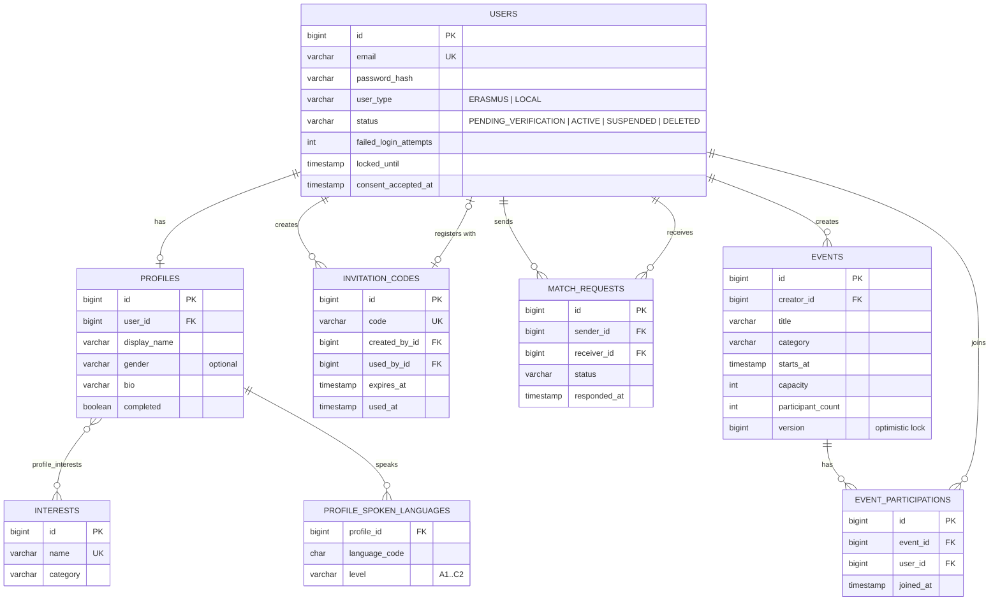

*Figure 3 — Entity-relationship diagram (main tables).*

### 2.5 Visual Interfaces

The screenshots below were taken from the **implemented React frontend** (`frontend/`), running against test data. The source images are in `docs/PA-2/screenshots/`. The layout is responsive (NFR-05) and the language can be switched at any time from the top bar (FR-14).

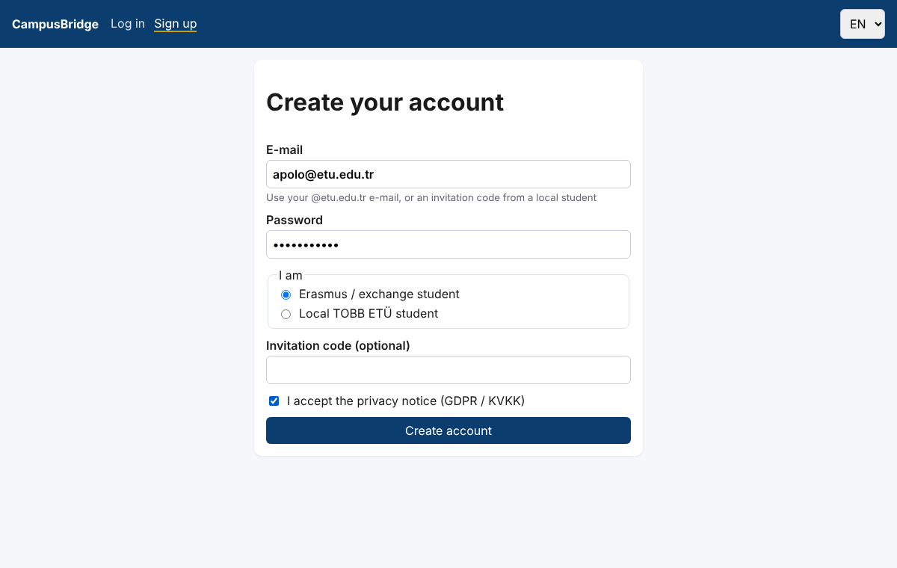

*Figure 4 — UC-1: registration with institutional e-mail or invitation code, and privacy consent.*

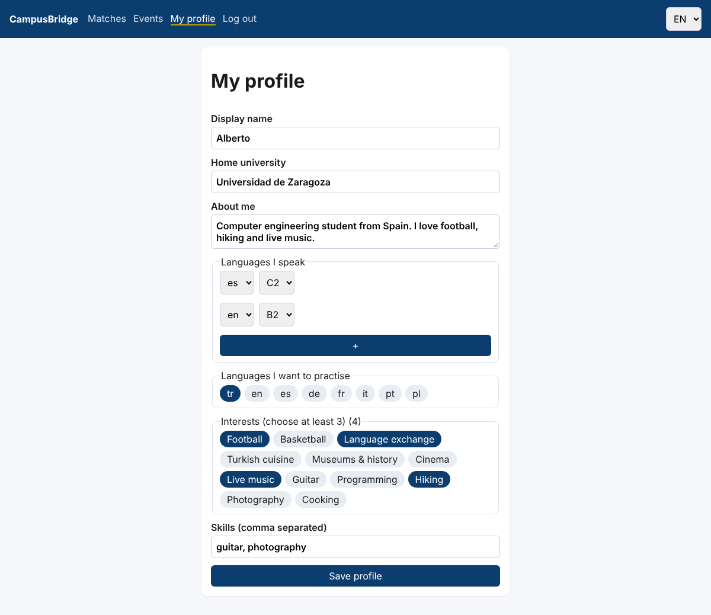

*Figure 5 — UC-2: profile form with languages and CEFR levels, languages to practise and at least 3 interests.*

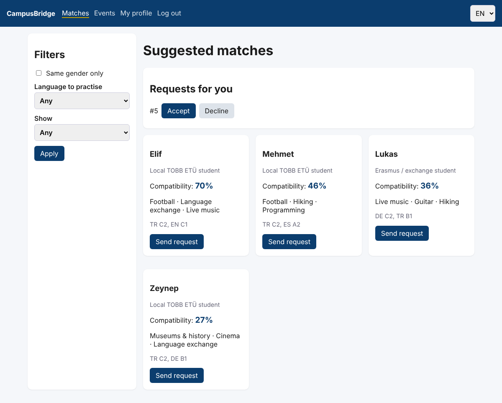

*Figure 6 — UC-3: filters (left), incoming requests and match suggestions ordered by compatibility.*

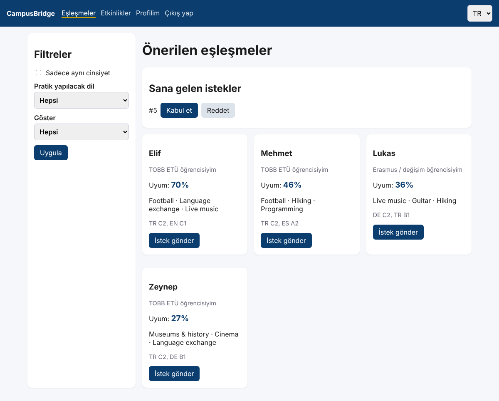

*Figure 7 — The same screen in Turkish (FR-14).*

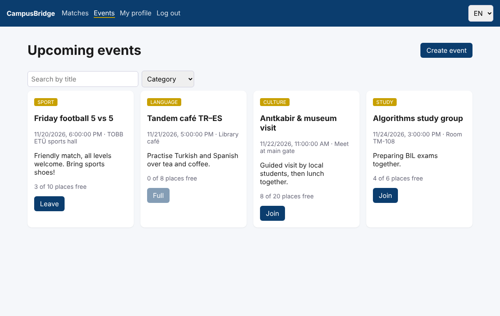

*Figure 8 — UC-4: upcoming events with free places; a full event cannot be joined.*

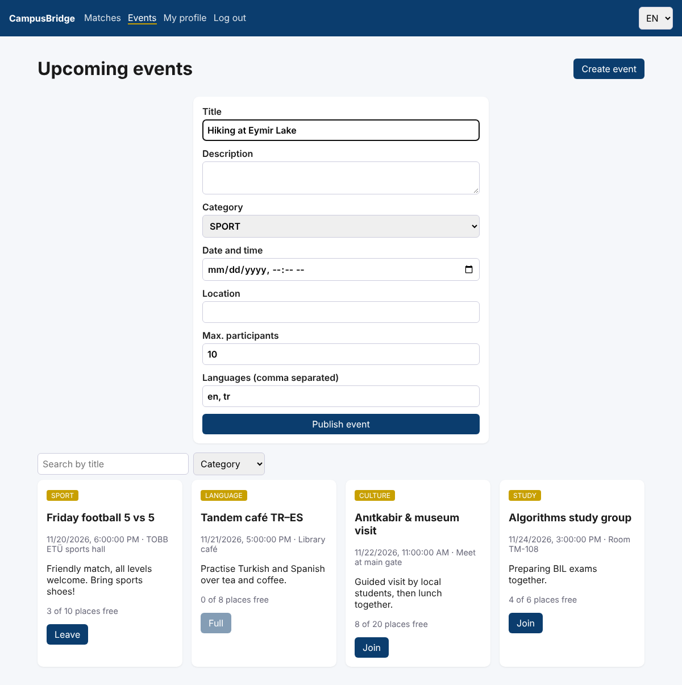

*Figure 9 — UC-4: create event form.*

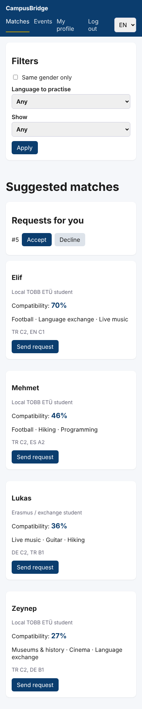

*Figure 10 — Mobile view (390 px wide) of the match suggestions.*

## 3. Use Case Support in Design

### 3.1 Use Case Selection

We selected the four use cases that form the **core flow of a new user**: an Erasmus student signs up (UC-1), describes themself (UC-2), finds compatible local students (UC-3) and meets them in real life at an activity (UC-4). Together they cover all the "Must" requirements of the main value of the platform and touch every layer and module of the architecture, so implementing them first reduces the most technical risk.

| ID | Use case | Primary actor | Why it is important |
| --- | --- | --- | --- |
| UC-1 | Register and log in | Guest (Erasmus or local student) | Entry point; only verified university members can use the platform (security, trust) |
| UC-2 | Create and edit profile | Student | Provides the data the matching algorithm needs |
| UC-3 | Get match suggestions and send a match request | Student | Main value of the product: connecting Erasmus and local students |
| UC-4 | Create and join an event | Student | Turns online matches into real-life contact |

### 3.2 Requirement Mapping

| Use case | Functional requirements (Requirements Document, PA-1) | Related NFRs |
| --- | --- | --- |
| UC-1 Register and log in | **FR-01** Registration with institutional e-mail, **FR-02** Registration with invitation code, **FR-03** Login, logout and password reset, FR-16 Consent (consent part) | NFR-02 Security, NFR-03 Privacy |
| UC-2 Create and edit profile | **FR-04** Create profile, **FR-05** View and edit profile, FR-14 Multi-language interface | NFR-04 Usability, NFR-06 Localisation |
| UC-3 Match suggestions and request | **FR-06** Match suggestions, **FR-07** User-controlled filters, **FR-08** Match requests | NFR-01 Performance, NFR-03 Privacy |
| UC-4 Create and join an event | **FR-09** Create event, **FR-10** Browse and search events, **FR-11** Join and leave events | NFR-05 Compatibility |

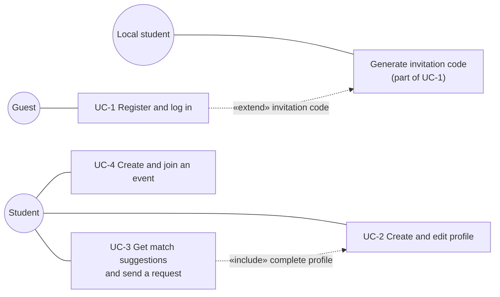

*Figure 11 — Use case diagram of the four selected use cases.*

### 3.3 UC-1: Register and Log In

**Actor:** guest (Erasmus or local student). **Precondition:** the user has no account. **Postcondition:** the account is active and the user is logged in.

**Main flow:**
1. The guest opens the registration page, enters e-mail, password and user type, and accepts the privacy notice.
2. `AuthController` validates the input (`@Valid RegisterRequest`) and calls `AuthService.register`.
3. `AuthServiceImpl` checks that the e-mail is not used and is institutional (`EmailDomainPolicy`).
4. The password is hashed (BCrypt), a `User` is saved with status `PENDING_VERIFICATION` and a 24-hour verification token.
5. `EmailSender` sends the verification link.
6. The user opens the link → `GET /auth/verify` → `User.verify()` changes the status to `ACTIVE`.
7. The user logs in → `POST /auth/login` → `TokenService` issues a token, which the frontend stores and sends in every request.

**Alternative flows:** (3a) non-institutional e-mail → an invitation code is required and `InvitationCodeService.consume()` validates it (unused, not expired), otherwise `409 INVALID_CODE`. (6a) expired link → `409 LINK_EXPIRED`. (7a) wrong password 5 times → account locked for 15 minutes (`409 ACCOUNT_LOCKED`). (7b) account not verified → `409 NOT_VERIFIED`.

**How the architecture supports it:** the eligibility rules are in the business layer (`AuthServiceImpl`, `InvitationCodeService`), while the account state rules are encapsulated in the `User` entity. External e-mail sending is behind the `EmailSender` interface, so tests do not send real e-mails. The whole registration runs in one transaction: if the invitation code is invalid, the new user is not saved either.

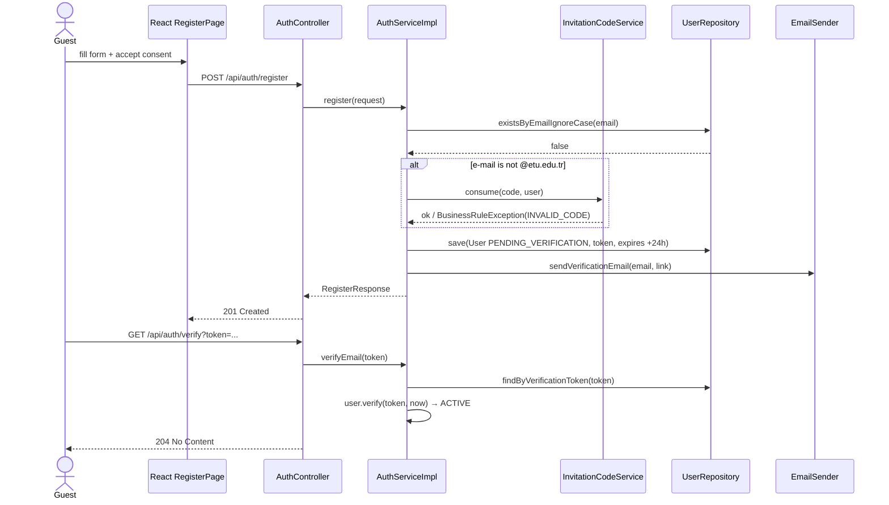

*Figure 12 — Sequence diagram of UC-1 (registration and verification).*

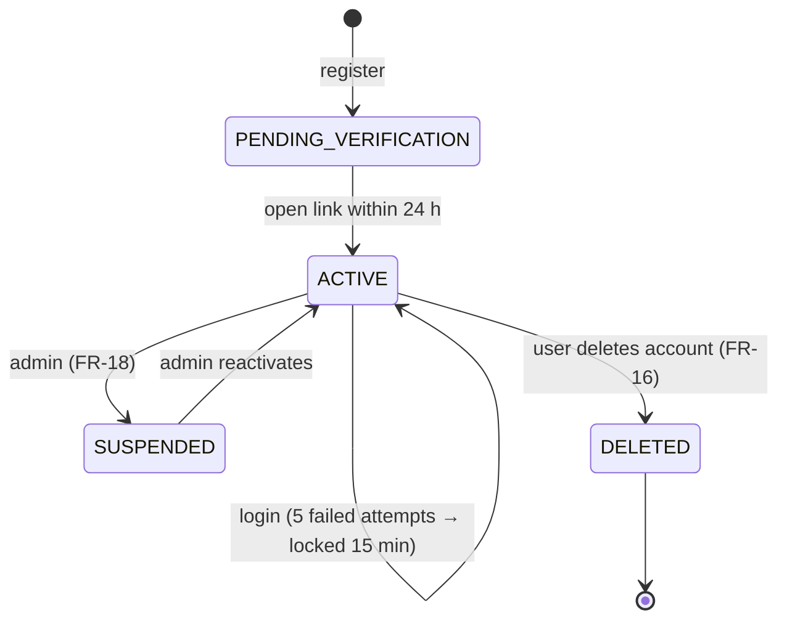

*Figure 13 — State diagram of a user account.*

**Data changes:** new row in `users`; for invitations, `invitation_codes.used_by_id` and `used_at` are set; on login, `failed_login_attempts` / `locked_until` are updated.

### 3.4 UC-2: Create and Edit Profile

**Actor:** logged-in student. **Precondition:** account is active. **Postcondition:** the profile is saved and, if it fulfils FR-04, marked as complete.

**Main flow:**
1. The frontend loads the interest catalogue (`GET /interests`) and the existing profile (`GET /profiles/me`, 404 the first time).
2. The student fills in name, home university, bio, spoken languages with level, languages to practise, at least 3 interests and skills.
3. `PUT /profiles/me` → `ProfileController` → `ProfileService.saveOwnProfile`.
4. The service loads the selected `Interest` entities; if fewer than 3 valid ones exist, it returns `409 PROFILE_INVALID`.
5. `Profile.update(...)` replaces the data and recalculates `completed`.
6. The response contains the profile as seen by the owner; other users see it through `GET /profiles/{id}` without gender or e-mail.

**Alternative flows:** (2a) bio longer than 500 characters or no spoken language → `400 VALIDATION_ERROR` from Bean Validation before reaching the service. (6a) the profile is incomplete → the matching module rejects the user with `409 PROFILE_INCOMPLETE` (Section 3.5).

**How the architecture supports it:** validation is done at two levels: format rules in the DTO (`@Size`, `@NotEmpty`, `@Pattern`) in the presentation layer, and rules that need the database (interests must exist in the catalogue) in the business layer. The same "upsert" endpoint is used for create and edit, which keeps the API small. The `completed` flag is the link between UC-2 and UC-3.

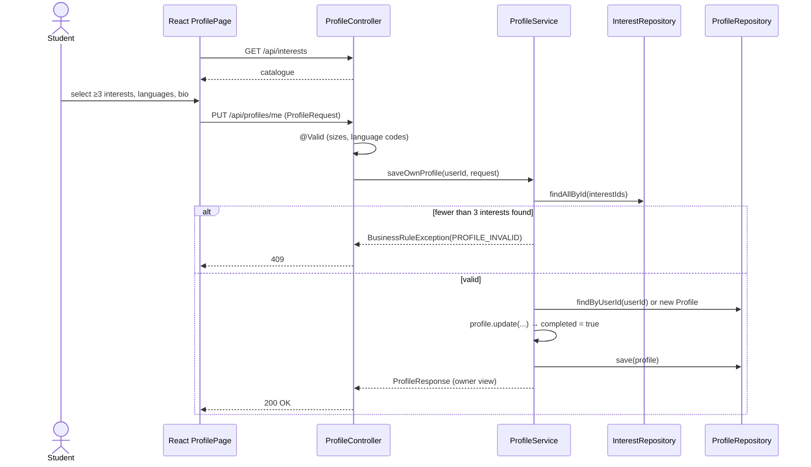

*Figure 14 — Sequence diagram of UC-2.*

**State change:** a profile is *incomplete* until it has ≥3 interests and ≥1 spoken language; then it becomes *complete* and visible to the matching algorithm. Editing can move it back to incomplete only if those rules are broken, which the UI prevents (the save button is disabled with fewer than 3 interests).

### 3.5 UC-3: Get Match Suggestions and Send a Match Request

**Actor:** student with a complete profile. **Postcondition:** a match request is created, and when the receiver accepts, both users appear in each other's match list.

**Main flow:**
1. The student opens the matches page → `GET /matches/suggestions` (with the saved filters, or with new filters and `useFilters=true`).
2. `MatchingService` checks that the requester's profile is complete.
3. It loads the candidate pool (`ProfileRepository.findMatchCandidates`: complete profiles of active users), and calculates the **excluded users** (pending/accepted requests in both directions, and users who declined the requester less than 30 days ago).
4. Profiles are mapped to `CandidateProfile` and passed to `MatchSuggestionEngine`, which filters, scores, sorts and returns the top 10 (Section 2.2.3).
5. The student presses *Send request* → `POST /match-requests` → a `MatchRequest` in state `PENDING` is saved and the receiver is notified.
6. The receiver sees the request in *Requests for you* and accepts (`POST /match-requests/{id}/accept`) → state `ACCEPTED`; the sender is notified.

**Alternative flows:** (2a) incomplete profile → `409 PROFILE_INCOMPLETE`. (4a) no candidate passes the filters → empty list and a hint to remove filters. (5a) there is already a pending/accepted request, or the receiver declined less than 30 days ago → `409 REQUEST_NOT_ALLOWED`. (6a) the receiver declines → `DECLINED`; the sender will not see this user for 30 days. (6b) a user other than the receiver tries to accept → `409 NOT_ALLOWED`.

**How the architecture supports it:** the expensive and most important logic (scoring) is isolated in the framework-free `matching.core` package, which makes it easy to test with many scenarios and to change the weights later without touching controllers or the database. The business layer adds the rules that need persisted data (exclusions, 30-day cool-down). The state machine prevents invalid transitions (e.g. accepting a request that was already cancelled) independently of how the endpoint is called.

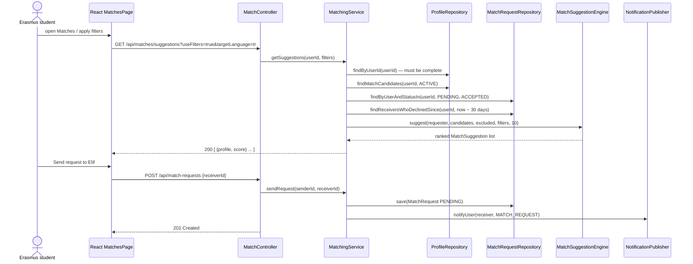

*Figure 15 — Sequence diagram of UC-3.*

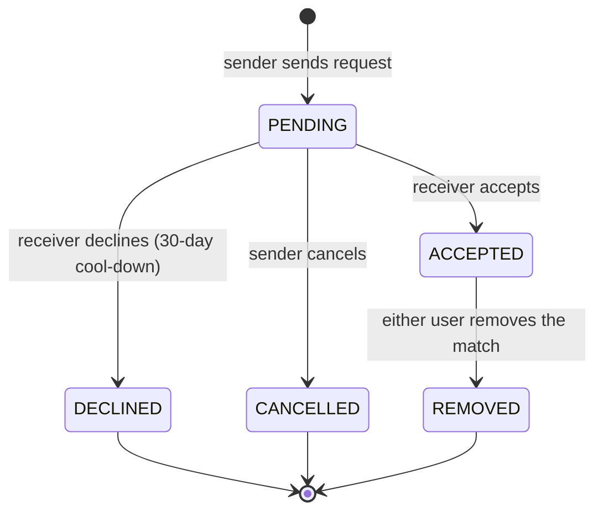

*Figure 16 — State diagram of a match request (`MatchRequestStatus`).*

**Data flow:** `profiles` + `profile_interests` + `profile_spoken_languages` → `CandidateProfile` (in memory) → `ScoreBreakdown` → JSON `SuggestionResponse`. Writing a request inserts one row in `match_requests`; answering it updates `status` and `responded_at`.

### 3.6 UC-4: Create and Join an Event

**Actor:** logged-in student. **Postcondition:** the event exists and the participant counter and participation list are consistent with the capacity.

**Main flow (create):**
1. The student fills in title, description, category, date and time, location, capacity (2–100) and languages.
2. `POST /events` → `EventController` (`@Future`, `@Min(2)`, `@Max(100)`) → `EventService.create`.
3. The `Event` constructor checks the business rules again (defence in depth); the creator is added as the first participant.

**Main flow (join):**
1. The student browses `GET /events` (filters: category, language, keyword, dates) and presses *Join*.
2. `POST /events/{id}/participants` → `EventService.join` checks that the user has not joined yet, calls `event.addParticipant(now)` and saves an `EventParticipation`.
3. The response contains the updated `participantCount` and `freePlaces`, which the UI shows immediately.

**Alternative flows:** (join-a) the event is full → `409 EVENT_FULL`, and the button shows *Full*. (join-b) already joined → `409 ALREADY_JOINED`. (join-c) two users take the last place at the same time → the second transaction fails because of the `@Version` check and the user can retry. (leave) `DELETE /events/{id}/participants/me` before the start time decreases the counter; the creator cannot leave but can cancel, which notifies all participants.

**How the architecture supports it:** the capacity invariant is protected in three places: the DTO validation (presentation), the `Event` entity methods (business) and the database (unique constraint + optimistic lock). Because all changes of one request happen inside a single `@Transactional` service method, the counter and the participation table can never get out of sync.

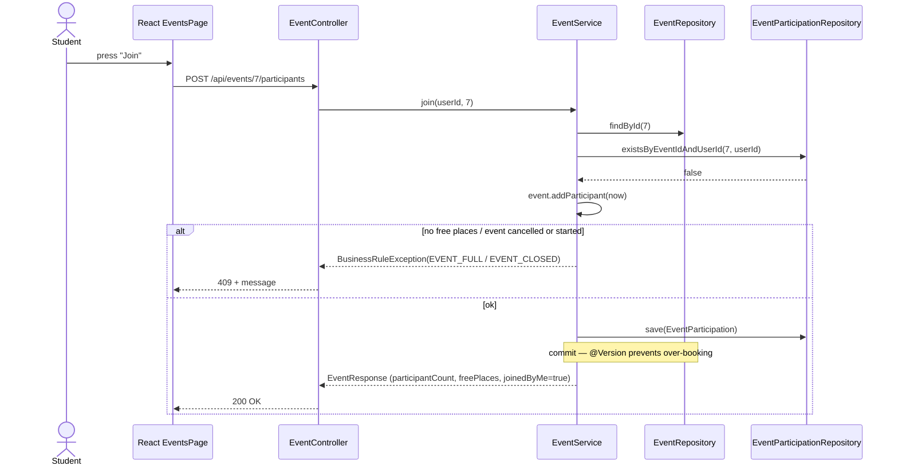

*Figure 17 — Sequence diagram of UC-4 (join an event).*

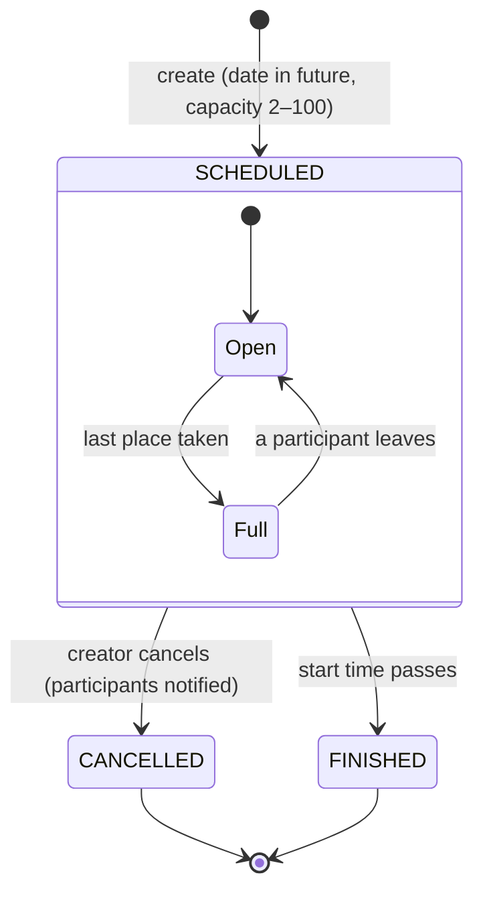

*Figure 18 — State diagram of an event ("Full" is derived from capacity and is not stored).*

### 3.7 Demo Requirement

The four use cases will be **fully implemented and demonstrated** in the final presentation with this scenario:

1. **UC-1:** a local student registers with an `@etu.edu.tr` e-mail, verifies it and creates an invitation code; an Erasmus student registers with a personal e-mail and that code. We also show the error for a used code and the lock after 5 wrong passwords.
2. **UC-2:** both students create their profiles; we show that the profile cannot be saved with fewer than 3 interests, and that the public profile hides gender and e-mail.
3. **UC-3:** the Erasmus student sees the local student among the top suggestions with the compatibility score, applies the "language to practise = TR" filter, sends a request; the local student accepts it and both see the match.
4. **UC-4:** the local student creates a football event with capacity 2; the Erasmus student joins; a third user sees the event as *Full*. The creator cancels and participants are notified.

Current status (15-11-2026): the backend services, entities, repositories and controllers of the four use cases and the frontend pages are implemented in the repository; the matching core, invitation codes and event rules are covered by unit tests. Remaining work for the demo (Sprints 1–2 of the Project Plan): JWT authentication filter, real e-mail sending, integration tests with the database, and deployment.

## 4. Design Decisions

### 4.1 Technology Comparisons

The code used for each comparison is committed in `tech-comparison/` (the same feature written with both technologies).

#### 4.1.1 Backend framework: Spring Boot (Java) vs Express (Node.js)

Snippets: `tech-comparison/backend/spring-boot/JoinEventExample.java` and `tech-comparison/backend/express/joinEvent.js` — "join an event with capacity check".

| Criterion | Spring Boot (chosen) | Express |
| --- | --- | --- |
| Language and typing | Java 21, static types checked by the compiler | JavaScript (dynamic); TypeScript is optional |
| Transactions | Declarative: `@Transactional` on the method | Manual `BEGIN` / `COMMIT` / `ROLLBACK` in each route |
| Validation | Bean Validation annotations on DTOs (`@Size`, `@Future`) | Manual checks or extra library (e.g. zod) |
| Database access | Spring Data JPA: repository interfaces, queries derived from method names | Hand-written SQL or extra ORM (Prisma, Sequelize) |
| Error handling | One `@RestControllerAdvice` for the whole API | Repeated in each route or custom middleware |
| Lines of code for the example | Longer overall but split into clear layers | Shorter to start, but one route mixes HTTP, SQL and rules |
| Team experience | All members studied Java in previous courses | Limited Node.js experience |
| Testing | JUnit 5 + Mockito, very mature | Jest / Mocha, also mature |

**Result:** Spring Boot. The comparison shows that the business rules of our project (transactions, validation, consistent errors) need much less hand-written code with Spring, and the team already knows Java.

#### 4.1.2 Database: PostgreSQL (relational) vs MongoDB (document)

Snippets: `tech-comparison/database/postgresql/{schema.sql, match_candidates.sql}` and `tech-comparison/database/mongodb/{profile_document.json, match_candidates.js}` — "profile storage and candidate query".

| Criterion | PostgreSQL (chosen) | MongoDB |
| --- | --- | --- |
| Data model | Tables with foreign keys (users, profiles, interests, requests, events) | One JSON document per profile; interests copied inside |
| Integrity | Foreign keys, `UNIQUE`, `CHECK`, `ON DELETE CASCADE` | No foreign keys; consistency handled in application code |
| Our relationships | Many-to-many (profiles ↔ interests, users ↔ events) expressed naturally with joins | Needs `$lookup` or duplicated data |
| Candidate query | One SQL query with joins and `NOT EXISTS` | Two queries + application code + aggregation pipeline |
| Transactions | Full ACID, used for event capacity | Multi-document transactions exist but are less common |
| Right to be forgotten (FR-16) | `ON DELETE CASCADE` removes all personal data | Must delete from every collection by hand |
| Flexibility of schema | Schema changes need migrations | Very flexible schema |
| Hosting | Free tiers on Render, Railway, Supabase (EU regions) | Free tier on MongoDB Atlas |

**Result:** PostgreSQL. Our data is highly relational and the integrity rules (capacity, unique participation, cascade deletion for GDPR/KVKK) are easier and safer with a relational database. MongoDB's main advantage, a flexible schema, is not important for us because the data structure is well defined in the requirements.

#### 4.1.3 Frontend framework: React vs Vue

Snippets: `tech-comparison/frontend/react/MatchCard.tsx` and `tech-comparison/frontend/vue/MatchCard.vue` — "match suggestion card".

| Criterion | React (chosen) | Vue 3 |
| --- | --- | --- |
| Syntax | JSX: markup inside TypeScript functions | HTML-like templates with directives (`v-if`, `@click`) |
| Type checking | Props and API types checked directly by `tsc` | Templates need extra tooling (`vue-tsc`) |
| Learning curve | Medium | Low |
| Ecosystem / jobs | Largest ecosystem (React Router, i18next, testing tools) | Large, but smaller |
| Multi-language support | `react-i18next` | `vue-i18n` |

**Result:** React with TypeScript. Both would work; we chose React because of its ecosystem, its strong TypeScript integration (we share the DTO types in `api/types.ts`), and because it is the most requested frontend skill, which is also a learning objective of the team.

### 4.2 Decision Justifications

**Architecture — layered monolith instead of microservices.**

| Criterion | Layered monolith (chosen) | Microservices |
| --- | --- | --- |
| Team size and time | Suitable for 4 students and one term | Needs more people and DevOps work |
| Deployment | One backend container, one database | Several services, service discovery, API gateway |
| Transactions | Local transactions (e.g. event capacity) | Distributed transactions or eventual consistency |
| Cost | Fits free hosting tiers | Several containers exceed free tiers |
| Scalability | Enough for a university (thousands of users); can be scaled horizontally | Scales each service separately |

The monolith is internally divided into **feature modules with clear interfaces**, so a module (for example, matching) could become a separate service in the future if needed. This follows the course principle of designing clear component interfaces and keeping the system as simple as possible.

**Database — PostgreSQL** (Section 4.1.2): relational data, integrity constraints, ACID transactions for capacity, cascade deletion for privacy laws, free managed hosting in the EU.

**Backend framework — Spring Boot** (Section 4.1.1): declarative transactions and validation, Spring Data repositories, dependency injection that makes classes easy to test with mocks, and the team's Java background.

**Frontend framework — React + TypeScript + Vite** (Section 4.1.3): component model, typed API contract, fast build tool, mature i18n library for the three languages.

**Other design decisions:**

- **REST + JSON instead of GraphQL:** our screens need simple, predictable resources; REST is easier to test with Postman and to secure, and it is what the team has learned.
- **Framework-free matching core:** keeps the most important algorithm independent from Spring and the database, so it is fast to unit-test and easy to change (e.g. new weights after the pilot).
- **Rich domain entities:** rules such as "event full" or "only the receiver can accept" are inside the entities, so they cannot be bypassed by a new endpoint.
- **Interfaces for external services and time** (`EmailSender`, `TokenService`, `NotificationPublisher`, `Clock`): allow fake implementations in tests and replacing providers without changing business code (dependency inversion).
- **Optimistic locking for event capacity:** simpler and faster than locking rows for every read, and conflicts are rare.
- **DTOs as Java records and TypeScript interfaces:** an explicit API contract; entities with sensitive fields are never serialised.

## 5. GitHub Commit Requirement

All implementations, interfaces, visual designs and comparison snippets are committed to the group repository. Each team member commits the parts they are responsible for from their own GitHub account (see the task matrix).

| Required item | Location in the repository |
| --- | --- |
| Code implementations of the 4 use cases | `backend/src/main/java/com/campusbridge/{auth,profile,matching,event}` and `frontend/src/pages` |
| Component interfaces | Service interfaces and signatures in the backend modules, REST controllers, `frontend/src/api/types.ts` |
| Unit tests | `backend/src/test/java/...`, `frontend/src/i18n/locales.test.ts` |
| Visual interface designs | `docs/PA-2/screenshots/` and the running frontend in `frontend/` |
| Technology comparison snippets | `tech-comparison/` (backend, database, frontend) |
| Design Document and QA Plan | `docs/PA-2/` (Markdown and PDF) |
| CI and bug tracking configuration | `.github/workflows/ci.yml`, `.github/ISSUE_TEMPLATE/bug_report.md` |

## 6. Document-Specific Task Matrix

| Task in the creation of this document | Responsible | Support |
| --- | --- | --- |
| 1.1 Brief project description | Turgay Samet Şentürk | — |
| 1.2 System architecture and diagram | Carlos Molina Perez | Alberto Alvarez Polo |
| 1.3 Technology stack | Carlos Molina Perez | Alejandro Blas Piris |
| 2.1 Codebase structure | Carlos Molina Perez | Alejandro Blas Piris |
| 2.2 Key implementations — auth and event modules | Carlos Molina Perez | Turgay Samet Şentürk |
| 2.2 Key implementations — profile module | Turgay Samet Şentürk | — |
| 2.2 Key implementations — matching algorithm | Alberto Alvarez Polo | — |
| 2.2 Key implementations — frontend and i18n | Alejandro Blas Piris | — |
| 2.3 Component interfaces and class diagram | Alberto Alvarez Polo | Carlos Molina Perez |
| 2.3 REST API endpoints | Carlos Molina Perez | Alejandro Blas Piris |
| 2.4 Data model (ER diagram) | Carlos Molina Perez | — |
| 2.5 Visual interfaces (screenshots) | Alejandro Blas Piris | — |
| 3.1 – 3.2 Use case selection and requirement mapping | Turgay Samet Şentürk | All members |
| 3.3 UC-1 design | Turgay Samet Şentürk | Carlos Molina Perez |
| 3.4 UC-2 design | Turgay Samet Şentürk | Alejandro Blas Piris |
| 3.5 UC-3 design | Alberto Alvarez Polo | — |
| 3.6 UC-4 design | Alejandro Blas Piris | Carlos Molina Perez |
| 3.7 Demo plan | Turgay Samet Şentürk | All members |
| 4.1 Backend and database comparisons | Carlos Molina Perez | Alberto Alvarez Polo |
| 4.1 Frontend comparison | Alejandro Blas Piris | — |
| 4.2 Decision justifications | Alberto Alvarez Polo | Carlos Molina Perez |
| Review, formatting and PDF conversion | Turgay Samet Şentürk | All members |
